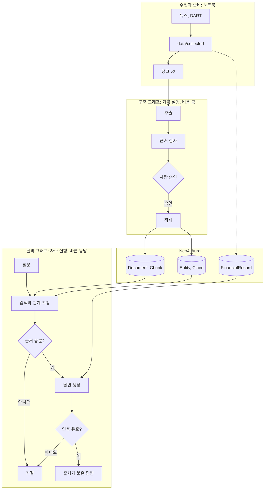
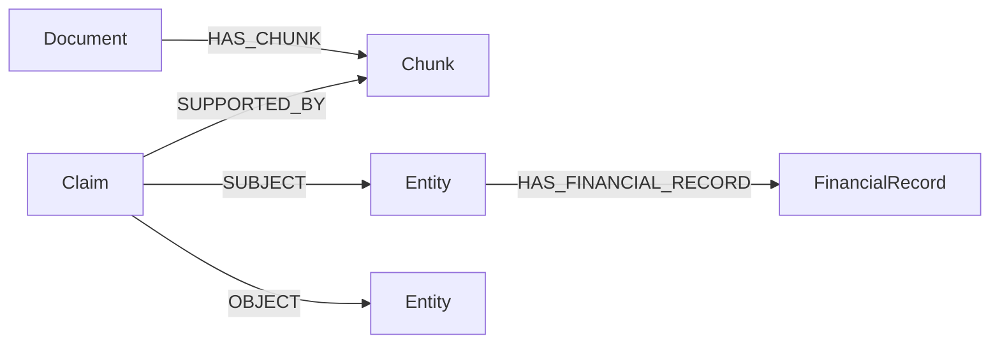
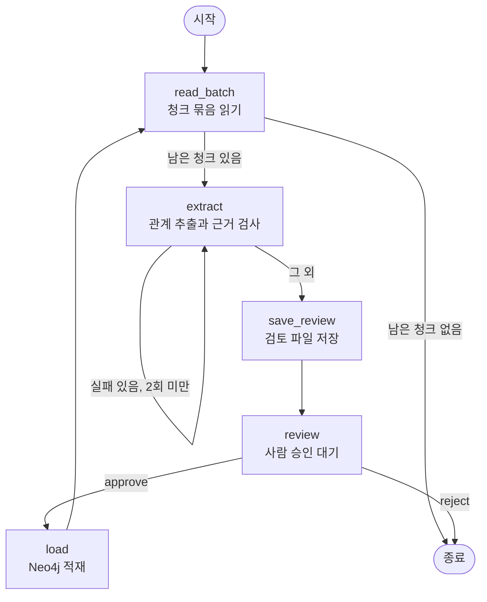
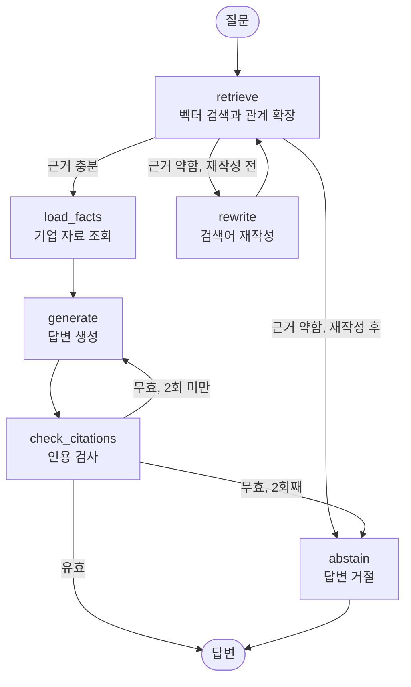
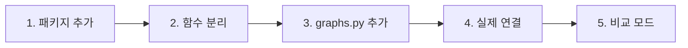
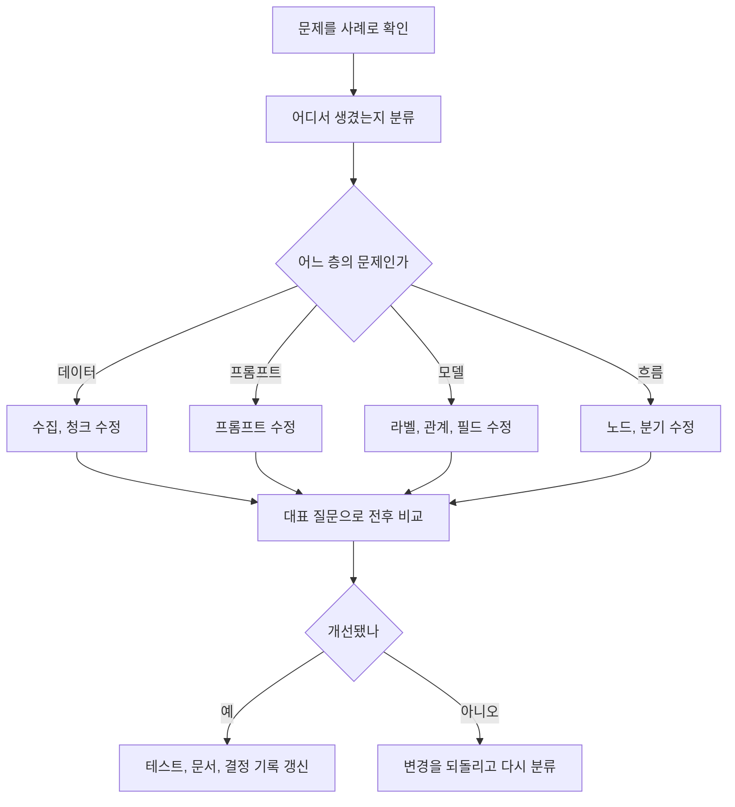

# LangGraph 설계 가이드

담당: 안나 · 기준일: 2026-11-06

이 문서는 GraphRAG의 처리 흐름을 LangGraph로 어떻게 설계하는지, 왜 그렇게 나누는지, 이후 기능을 어떻게 추가할지 설명합니다. 코드를 따라 치는 문서가 아니라 **설계 판단을 이해하고 직접 바꿀 수 있게 하는 문서**입니다.

Mermaid 그림은 GitHub와 VS Code의 Markdown 미리보기에서 볼 수 있습니다. VS Code에서는 Mermaid 미리보기 확장이 필요할 수 있습니다.

| 부분 | 내용 |
|---|---|
| 1~2장 | 왜 LangGraph를 쓰는지, 핵심 개념 |
| 3장 | 그래프를 설계하는 순서 |
| 4~6장 | 이 프로젝트의 설계와 이유 |
| 7장 | 기존 코드에서 옮기는 순서 |
| 8~9장 | 개선과 추가 작업 방법 |
| 부록 | 테스트를 통과한 기준 코드 |

## 1. 왜 LangGraph를 쓰는가

현재 `pipeline.py`는 명령을 하나씩 실행합니다. 소량 실험에는 충분합니다. 하지만 규모가 커지면 흐름 자체를 다뤄야 하는 문제가 생깁니다.

| 지금 생기는 문제 | 현재 방식 | LangGraph 사용 시 |
|---|---|---|
| 추출 중 오류로 멈춤 | 새 출력 파일로 처음부터 다시 실행 | 체크포인트에서 이어서 실행 |
| 검토 전에 적재되면 안 됨 | 사람이 순서를 기억해 명령 실행 | 승인 단계에서 그래프가 멈춤 |
| 근거가 부족한 질문 | 약한 근거로도 답변 생성 | 조건에 따라 재검색 또는 답변 거절 |
| 잘못된 출처가 답변에 포함 | 사람이 읽고 찾아야 함 | 인용 검사 후 다시 생성 |
| 흐름 설명과 코드가 따로 놂 | 문서를 따로 관리 | 코드에서 구조 그림을 뽑을 수 있음 |

단계가 일직선이고 분기, 재시도, 사람 개입이 없다면 LangGraph가 필요 없습니다. 그래서 `prepare.py`의 청크 생성처럼 한 번에 끝나는 일은 그래프로 만들지 않습니다.

**LangGraph는 추출 품질이나 검색 정확도를 높여 주지 않습니다.** 흐름을 통제할 뿐입니다. 품질은 프롬프트, 데이터, 그래프 모델, 평가에서 결정됩니다.

## 2. 핵심 개념

| 개념 | 뜻 | 이 프로젝트의 예 |
|---|---|---|
| State | 노드들이 함께 보는 작업 메모 | 질문, 찾은 근거, 답변 |
| Node | 한 가지 일을 하는 함수. 바꿀 State 값만 돌려줌 | `retrieve`, `generate` |
| Edge | 다음에 실행할 노드 | `load_facts` 다음은 `generate` |
| Conditional edge | State를 보고 다음 노드를 고르는 분기 | 점수가 낮으면 `rewrite` |
| Checkpointer | 단계마다 State를 저장하는 장치 | 추출 도중 멈춰도 이어서 실행 |
| Interrupt | 그래프를 멈추고 사람의 입력을 기다림 | 적재 전 승인 |

노드는 이렇게 생겼습니다. State를 받고, 바뀐 값만 돌려줍니다.

```python
def rewrite(state):
    return {"search_query": deps.rewrite(state["question"]),
            "rewrites": state.get("rewrites", 0) + 1}
```

분기 함수는 일을 하지 않고 **다음 노드의 이름만 돌려줍니다.**

```python
def after_check(state):
    if state["citations_ok"]:
        return END
    return "generate" if state["generations"] < MAX_GENERATIONS else "abstain"
```

## 3. 그래프를 설계하는 순서

코드부터 쓰지 않습니다. 새로운 기능을 추가할 때도 이 순서를 그대로 따릅니다.

### 1단계. 일직선 흐름을 적는다

```text
질문 → 검색 → 답변 생성
```

### 2단계. 실패와 판단 지점을 찾는다

단계마다 묻습니다. **실패하면 어떻게 되나? 사람이 봐야 하나? 결과가 나쁘면 어떻게 아나?**

| 단계 | 실패나 판단 | 대응 |
|---|---|---|
| 검색 | 관련 근거가 없음 | 재검색 또는 거절 |
| 답변 생성 | 검색하지 않은 문서를 인용 | 다시 생성 또는 거절 |

이 지점이 없으면 그래프가 아니라 함수로 충분합니다.

### 3단계. 상태를 정한다

**분기에 필요한 값과 다음 노드에 넘길 값만 넣습니다.** API 클라이언트, DB 연결, 비밀값, 임베딩 벡터는 넣지 않습니다. State는 체크포인트에 저장되기 때문입니다.

### 4단계. 노드 경계를 나눈다

아래 중 하나라도 해당하면 별도 노드로 나눕니다.

- 비용이 드는 호출이라 다시 실행하면 안 된다
- 이 지점에서 재시도하거나 멈춰야 한다
- 앞의 결과에 따라 실행 여부가 달라진다
- 혼자 테스트할 가치가 있다

해당하지 않으면 노드를 늘리지 않습니다. 함수 호출로 충분합니다.

### 5단계. 끝나는 것을 보장한다

되돌아가는 선이 있으면 **반드시 횟수 제한**을 둡니다. 없으면 비용이 끝없이 나갈 수 있습니다. 모든 경로가 종료 또는 거절로 이어지는지 그림에서 확인합니다.

### 6단계. 가짜 연결로 흐름을 테스트한다

OpenAI나 Neo4j 없이 분기만 검증합니다. 그래서 외부 연결을 `deps`로 받습니다. 비용 없이 초 단위로 끝납니다.

### 7단계. 그림과 코드를 맞춘다

코드에서 구조를 뽑아 이 문서의 그림과 비교합니다.

```python
print(graph.get_graph().draw_mermaid())
```

## 4. 전체 아키텍처



### 왜 그래프를 두 개로 나누나

| 기준 | 구축 그래프 | 질의 그래프 |
|---|---|---|
| 실행 빈도 | 데이터를 늘릴 때 | 질문할 때마다 |
| 실행 시간 | 몇 분에서 몇 시간 | 몇 초 |
| 사람 개입 | 적재 전 승인 | 없음 |
| 체크포인트 | 필수 | 필요 없음 |
| 실패 대응 | 이어서 실행 | 다시 묻거나 거절 |

성격이 달라서 한 그래프에 넣으면 분기만 복잡해집니다. 둘의 접점은 Neo4j 데이터뿐입니다.

### 데이터 모델



관계를 Entity 사이의 선으로 바로 잇지 않고 `Claim` 노드로 두었습니다. 관계마다 근거 문장, 상태, 검토 여부를 붙이고 원문까지 추적하기 위해서입니다.

## 5. 구축 그래프



| 노드 | 하는 일 | 쓰는 기존 코드 | 분리한 이유 |
|---|---|---|---|
| `read_batch` | 청크 일부 읽기 | `read_jsonl` | 묶음 단위로 승인하고 이어서 실행 |
| `extract` | 실패한 청크만 추출 | `extract_chunk` | 비용이 들고 재시도 지점 |
| `save_review` | 검토 파일 저장 | 새로 작성 | 부작용을 승인 대기와 분리 |
| `review` | 사람 결정 대기 | 없음 | 그래프를 멈출 지점 |
| `load` | 임베딩과 적재 | `run_load`의 반복문 내부 | 승인 후에만 실행 |

### 왜 이렇게 만드나

**묶음(batch)으로 처리합니다.** 청크 12,309개를 한 번에 추출하고 나서 잘못된 것을 알면 비용을 버립니다. 작게 나눠 승인하면 문제를 초기에 발견합니다.

**재시도는 실패한 청크만 합니다.** 성공한 청크를 다시 호출하면 비용이 이중으로 듭니다. `extract`가 오류를 잡아 `failed`에 모으는 이유입니다. 묶음 전체를 예외로 끝내면 성공한 결과까지 잃습니다.

**실패 청크는 건너뛰고 기록합니다.** 2회 실패한 청크는 오류 내용과 함께 승인 화면과 검토 파일에 나오고, 승인 후 `unprocessed`에 쌓입니다. 한 청크 때문에 전체가 멈추지 않게 하면서, 빠진 청크를 나중에 찾을 수 있게 하기 위해서입니다. 재처리는 `unprocessed`의 청크로 새 실행을 시작합니다.

**재시도와 장애 복구는 다릅니다.** API 오류처럼 코드가 잡는 실패는 위 재시도로 처리합니다. 프로그램이 강제로 종료되면 다릅니다. 체크포인트는 노드가 끝날 때 저장되므로, `extract` 도중 꺼지면 그 묶음을 처음부터 다시 호출합니다. 묶음을 작게 두면 다시 내는 비용이 그 묶음으로 제한됩니다. 이 비용이 문제가 될 만큼 묶음을 키워야 한다면 청크별 노드나 진행 기록을 검토합니다.

**`review` 노드에서는 interrupt만 합니다.** LangGraph는 재개할 때 **그 노드를 처음부터 다시 실행**합니다. 같은 노드에 파일 저장이나 API 호출이 있으면 재개할 때 또 실행됩니다. 그래서 `save_review`를 앞에 따로 둡니다. 이 규칙은 interrupt를 쓰는 모든 곳에 적용합니다.

**승인과 사실 검증은 다릅니다.** 승인은 "이 묶음을 그래프에 넣어도 된다"는 뜻입니다. 각 `Claim`의 `review_status`는 계속 `unreviewed`로 둡니다. 개별 판정 결과만 나중에 이 값을 바꿉니다.

**체크포인트는 `private_data/`에 둡니다.** State에 기사 본문이 포함된 청크가 들어가므로 체크포인트 DB에도 본문이 저장됩니다.

## 6. 질의 그래프



| 노드 | 하는 일 | 쓰는 기존 코드 | 분리한 이유 |
|---|---|---|---|
| `retrieve` | 청크 검색과 관계 확장 | `run_ask`의 첫 쿼리 | 재시도 지점, 검색 방식을 바꿀 수 있음 |
| `rewrite` | 검색어 재작성 | 새로 작성 | 근거가 약할 때만 실행 |
| `load_facts` | 기업, 재무 조회 | `run_ask`의 둘째 쿼리 | 근거가 충분할 때만 실행 |
| `generate` | 답변 생성 | `run_ask`의 `response_text` 호출 | 비용, 재시도 지점 |
| `check_citations` | 인용 문서 ID 검사 | 새로 작성 | 비용 없는 품질 관문 |
| `abstain` | 답변 거절 | 새로 작성 | 모든 실패가 모이는 끝 |

### 왜 이렇게 만드나

**인용 검사는 AI가 아니라 규칙으로 합니다.** 답변에 나온 `NEWS-...` 전부가 검색한 문서에 있는지만 봅니다. 하나라도 없으면 실패입니다. 비용이 없고 결과가 항상 같고 테스트하기 쉽습니다. 이것으로 "검색 안 한 문서 인용"은 막지만 "문서를 읽고 잘못 해석"은 막지 못합니다. 그 평가는 대표 질문과 사람 검토로 합니다.

**재작성은 1회, 생성은 최대 2회입니다.** 질의는 응답 시간과 비용이 중요합니다. 한 번 고쳐서 안 되는 문제는 대부분 데이터에 근거가 없는 경우입니다.

**근거가 없으면 답하지 않습니다.** 없는 답을 만드는 것보다 "답할 수 없다"가 낫습니다. 이 프로젝트의 핵심 가치는 답변의 근거입니다.

**`MIN_SCORE = 0.3`은 임시값입니다.** 측정으로 정한 값이 아닙니다. 대표 질문과 관련 없는 질문의 점수를 비교해 정합니다.

**LangGraph의 메시지 상태나 에이전트 도구 호출을 쓰지 않습니다.** 흐름이 고정되어 있어 필요 없습니다. AI가 다음 단계를 스스로 고르게 하면 비용과 결과 예측이 어려워지고 비교 평가도 어려워집니다.

## 7. 기존 코드에서 옮기는 순서

**새 파이프라인을 만드는 것이 아닙니다.** `pipeline.py`의 함수를 재사용하고, 기존 CLI는 남겨 둡니다. 시작 시점은 S2-2의 소량 추출과 S2-3의 검토가 CLI로 동작한 뒤입니다.



### 1단계. 패키지 추가

```bash
git checkout -b anna/langgraph
uv add 'langgraph>=1.2.20,<2' 'langgraph-checkpoint-sqlite>=3.1.3'
```

### 2단계. 함수 분리

동작을 바꾸지 말고 `pipeline.py`에서 함수만 꺼냅니다. 기존 테스트가 그대로 통과해야 합니다.

| 새 함수 | 꺼낼 위치 | 포함 범위 | 반환 |
|---|---|---|---|
| `ensure_schema(db)` | `run_load`의 `for` 앞 | 제약 조건, 벡터 인덱스 생성 | 없음 |
| `load_record(db, record)` | `run_load`의 `for` 내부 | `graph_rows`, 임베딩, 적재 쿼리 | `Claim` 수 |
| `search_evidence(db, text, limit)` | `run_ask`의 첫 쿼리 | `embedding` 호출, 쿼리, `r.data()` 변환 | dict 목록 |
| `company_facts(db)` | `run_ask`의 둘째 쿼리 | 쿼리, `r.data()` 변환 | dict 목록 |
| `answer(question, evidence, facts, model)` | `run_ask`의 프롬프트 부분 | 프롬프트 조립, `response_text` | 답변 문자열 |

분리 후 `run_load`, `run_ask`는 이 함수들을 호출하도록 고칩니다. `ensure_schema`는 묶음마다 부르지 않고 실행을 시작할 때 한 번 호출합니다.

### 3단계. `graphs.py` 추가

부록의 `src/bulsae/graphrag/graphs.py`와 `tests/test_graphrag_graphs.py`를 추가하고 테스트합니다. 이 단계는 비용이 들지 않습니다.

```bash
uv run python -m unittest discover -s tests
```

### 4단계. 실제 연결

`pipeline.py`에 새 명령 `index-graph`, `ask-graph`를 추가합니다. 연결부 예시입니다. 실제 DB로 실행한 코드는 아니므로 소량으로 확인합니다.

```python
from itertools import islice
from langgraph.checkpoint.sqlite import SqliteSaver
from langgraph.types import Command
from bulsae.graphrag import graphs


def read_batch(path, batch, size):
    return list(islice(read_jsonl(path), batch * size, (batch + 1) * size))


def query_deps(db, model, limit):
    return graphs.QueryDeps(
        search=lambda text: search_evidence(db, text, limit),
        company_facts=lambda: company_facts(db),
        rewrite=lambda question: response_text({"model": model, "store": False,
            "input": "다음 질문을 뉴스 검색에 맞는 짧은 검색어로 바꿔라. 검색어만 출력하라.\n" + question}),
        generate=lambda question, evidence, facts: answer(question, evidence, facts, model))
```

구축 그래프의 연결입니다. 레코드에는 추출 때 쓴 모델명이 함께 저장되므로 `load_record`의 `record["model"]`을 그대로 쓸 수 있습니다.

```python
def index_deps(db, path, size, model, run_name):
    def save_review(batch, records, errors):
        output = Path(f"private_data/{run_name}_review_{batch}.jsonl")
        with output.open("x", encoding="utf-8") as file:
            for record in records:
                file.write(json.dumps(record, ensure_ascii=False) + "\n")
            for chunk_id, error in errors.items():
                file.write(json.dumps({"failed_chunk": chunk_id, "error": error},
                                      ensure_ascii=False) + "\n")
        return str(output)

    def load_records(records):
        for record in records:
            load_record(db, record)
        return len(records)

    return graphs.IndexDeps(
        model=model,
        read_batch=lambda batch: read_batch(path, batch, size),
        extract=lambda chunk: extract_chunk(chunk, model),
        save_review=save_review, load_records=load_records)
```

구축 그래프는 체크포인트와 실행 이름을 지정합니다.

```python
with SqliteSaver.from_conn_string("private_data/index_checkpoints.sqlite") as saver:
    graph = graphs.build_index_graph(deps, saver)
    config = {"configurable": {"thread_id": args.run_name}}
    result = graph.invoke({}, config)                      # 첫 실행
    result = graph.invoke(Command(resume="approve"), config)  # 승인 후 재개
```

재개는 별도 명령으로 분리합니다. 첫 실행 뒤 프로그램을 끝내고 검토 파일을 본 다음, 같은 `run_name`으로 다시 실행하면 멈춘 곳에서 이어집니다.

**재개할 때는 입력 파일, 묶음 크기, 모델이 처음과 같아야 합니다.** 묶음을 `batch * size` 위치로 읽기 때문에 크기가 바뀌면 청크가 빠지거나 겹칩니다. 첫 실행 때 설정을 저장하고 재개할 때 비교합니다.

```python
settings = {"input": str(args.chunks), "batch_size": args.batch_size, "model": args.model}
path = Path(f"private_data/{args.run_name}_settings.json")
if path.exists():
    if json.loads(path.read_text(encoding="utf-8")) != settings:
        raise ValueError("재개 설정이 첫 실행과 다릅니다. 새 run_name을 쓰세요.")
else:
    path.write_text(json.dumps(settings, ensure_ascii=False), encoding="utf-8")
```

처음에는 묶음 크기 5로 시작합니다. 비용이 드는 명령이므로 실행 전 대상 청크 수를 확인합니다.

### 5단계. 비교 모드

S3-1의 일반 검색 비교에 사용합니다. 질의 그래프는 외부 연결을 `deps`로 받으므로 **같은 그래프에서 검색 함수만 바꿉니다.** 구조화 자료, 재작성, 답변 생성은 양쪽이 같습니다.

```python
vector_deps = graphs.QueryDeps(
    search=lambda text: search_chunks_only(db, text, limit),  # 관계 확장 없음
    company_facts=base.company_facts,
    rewrite=base.rewrite, generate=base.generate)
```

`search_chunks_only`는 `search_evidence`에서 `claims`, `related`를 빼고 벡터 검색만 수행합니다. 이렇게 하면 두 방식의 차이가 검색 방법에서만 나옵니다. `ask-graph`에 `--mode vector|graph` 옵션을 둡니다.

## 8. 설계 결정 기록

중요한 결정은 아래 표에 남깁니다. 나중에 왜 이렇게 했는지 찾지 않아도 되고, 언제 바꿔도 되는지 알 수 있습니다.

| 결정 | 이유 | 고려한 대안 | 다시 검토할 조건 |
|---|---|---|---|
| 그래프 2개로 분리 | 실행 주기, 비용, 사람 개입이 다름 | 그래프 1개 | 두 흐름이 실시간으로 연결될 때 |
| 묶음 단위 승인 | 초기 오류 발견, 비용 통제 | 청크별 승인 | 승인 부담이 커지고 품질이 안정될 때 |
| 2회 실패 청크는 건너뛰고 기록 | 한 건 때문에 전체를 멈추지 않음 | 실패 시 전체 중단 | 실패가 묶음의 상당 부분을 차지할 때 |
| 외부 연결을 `deps`로 주입 | 비용 없는 테스트, 비교 모드 | 노드에서 직접 호출 | 없음 |
| 규칙 기반 인용 검사 | 비용 없음, 결과 일정 | LLM 평가 | 잘못된 해석이 주요 오류로 측정될 때 |
| 재작성 1회, 생성 2회 제한 | 응답 시간, 비용 | 무제한 반복 | 측정 결과 추가 시도가 효과 있을 때 |
| 고정된 흐름 | 예측 가능, 평가 쉬움 | 에이전트 도구 호출 | 질문 유형별로 필요한 도구가 크게 다를 때 |
| 체크포인트 SQLite | 파일 하나, 설치 간단 | Postgres | 여러 프로세스가 동시에 실행할 때 |

## 9. 개선과 추가 작업 방법

### 접근 순서

기능부터 추가하지 않습니다. 아래 순서를 따릅니다.



1. **문제를 사례로 적습니다.** "검색이 안 좋다"가 아니라 어떤 질문에서 어떤 문서가 빠졌는지 적습니다.
2. **전후를 비교할 기준을 정합니다.** 성현의 `question_evidence.csv`로 찾은 근거와 놓친 근거를 셉니다.
3. **가장 작은 변경부터 합니다.** 프롬프트 한 줄로 되면 노드를 추가하지 않습니다.
4. **한 번에 하나만 바꿉니다.** 여러 개를 함께 바꾸면 무엇이 효과가 있었는지 모릅니다.
5. **재적재가 필요한지 먼저 확인합니다.** 관계 종류나 청크가 바뀌면 다시 추출해야 하므로 비용이 큽니다.

### 어디를 고칠까

| 증상 | 먼저 볼 곳 | 고치는 위치 |
|---|---|---|
| 관련 없는 기사가 많음 | 뉴스 판정 결과 | 수집 필터 |
| 인용 거부가 많음 | `rejected`의 사유 | 추출 프롬프트 |
| 잘못된 관계가 많음 | 관계 판정 결과 | 프롬프트, 관계 종류 |
| 같은 회사가 여러 노드 | `Entity` 이름 | `entity_id`, 개체 통합 |
| 검색이 못 찾음 | 검색 점수와 청크 | 청크, 임베딩 텍스트 |
| 근거는 찾았지만 답이 나쁨 | 프롬프트에 들어간 내용 | `answer` 프롬프트 |
| 멈춘 뒤 다시 실행됨 | 노드의 부작용 위치 | 노드 분리 |
| 비용이 큼 | 재시도와 재추출 횟수 | 분기 조건, 묶음 크기 |

### 노드를 추가하는 방법

1. 3장의 질문으로 정말 노드가 필요한지 확인합니다.
2. 필요한 State 필드를 추가합니다.
3. 외부 호출이 있으면 `deps`에 함수를 추가합니다.
4. 노드와 분기를 추가합니다. 되돌아가는 선이면 횟수 제한을 넣습니다.
5. 정상, 실패, 제한 초과를 테스트로 추가합니다.
6. `draw_mermaid()` 결과로 이 문서의 그림을 고칩니다.
7. 체크포인트 형식이 바뀌었다면 진행 중인 실행을 끝내고 새 `thread_id`로 시작합니다.

### 개선 후보

순서대로 할 필요는 없습니다. **시작 조건이 측정됐을 때만** 진행합니다.

| 개선 | 시작 조건 | 접근 방법 | 주의 |
|---|---|---|---|
| 구조화 자료 인용 허용 | 재무 질문이 인용 없음으로 거절됨 | `cited_documents`에 `FINANCIAL-` ID 추가, `facts` ID를 허용 목록에 추가 | 현재 재무만으로 만든 답변은 거절됩니다 |
| 7개사 구조화 적재 | 대표 질문에 다른 기업 재무가 필요 | `run_structured`의 대상 필터 제거 | ID 중복 확인 |
| 개체 통합 | 같은 회사가 나뉘어 관계 탐색이 끊김 | `extract`와 `load` 사이에 `normalize_entities` 노드 추가 | 동명이인 오결합 위험, 재적재 필요 |
| 질문 유형 분기 | 질문 유형별로 필요한 자료가 분명히 다름 | `retrieve` 앞에 `classify` 노드 추가. 규칙부터 시작 | 먼저 대표 질문으로 효과 측정 |
| 공시 문서 추가 | 뉴스로 답하지 못하는 질문이 확인됨 | 공시 본문 청크를 만들어 같은 구축 그래프에 입력 | `document_id` 형식과 출처 유형 구분, 이용 조건 확인 |
| 관계 판정 결과 반영 | 성현의 판정 결과가 쌓임 | `claim_review.csv`를 읽어 `review_status` 갱신. `generate`에서 판정 상태 전달 | 표본 결과를 전체에 일반화하지 않음 |
| 근거 평가 LLM 노드 | 규칙 통과 후 해석 오류가 주요 문제로 측정됨 | `check_citations` 뒤에 평가 노드 추가 | 비용, 응답 시간 증가 |
| 추출 병렬화 | 실행 시간이 실제 문제가 되고 API 한도 여유가 있음 | `Send`로 청크별 작업 분할 | 한도 초과, 실패 모으기 복잡 |
| 답변 스트리밍, 웹 화면 | 데모 요구사항에 있음 | 그래프를 함수로 호출하는 API 추가 | 그래프 구조는 유지 |

### 지금 넣지 않는 것

| 항목 | 이유 |
|---|---|
| 멀티 에이전트 구조 | 고정된 흐름으로 충분합니다 |
| 장기 메모리, 대화 기록 | 한 질문씩 평가하는 단계입니다 |
| 웹 검색 도구 | 저장된 근거 안에서 답하는 것이 목표입니다 |
| 복잡한 재순위 모델 | 측정된 문제가 아직 없습니다 |

## 10. 자주 하는 실수

| 실수 | 왜 문제인가 | 올바른 방법 |
|---|---|---|
| interrupt 앞에 파일 저장이나 API 호출 | 재개할 때 다시 실행됨 | 앞 노드로 분리 |
| 횟수 제한 없는 되돌림 | 비용이 끝없이 나감 | 제한과 거절 경로 |
| State에 벡터나 DB 연결 저장 | 저장 실패, 체크포인트 비대화 | 함수는 `deps`, State에는 값만 |
| 노드 안에서 다음 경로 결정 | 흐름이 숨어 그림과 달라짐 | 분기는 Conditional edge에서 |
| 체크포인트 파일 커밋 | 기사 본문 공개 | `private_data/`에 저장 |
| 같은 `thread_id` 재사용 | 이전 실행에 이어짐 | 실행마다 새 이름 |
| 재개 때 묶음 크기 변경 | 청크 누락이나 중복 | 설정 저장 후 비교 |
| 그래프가 품질을 올린다고 기대 | 흐름만 통제함 | 평가로 원인 분류 |
| 평가 없이 노드 추가 | 복잡도만 늘어남 | 전후 비교 |

## 11. 체크리스트

- [ ] S2의 소량 추출을 CLI로 확인했다
- [ ] 패키지를 추가했다
- [ ] 함수를 분리했고 기존 테스트가 통과한다
- [ ] `graphs.py`와 테스트를 추가했다
- [ ] `index-graph`를 묶음 5로 실행하고 승인 대기에서 멈추는 것을 확인했다
- [ ] 프로그램을 종료한 뒤 같은 실행 이름으로 재개했다
- [ ] 거절하면 적재되지 않는 것을 확인했다
- [ ] 실패 청크가 검토 파일과 `unprocessed`에 남는 것을 확인했다
- [ ] `ask-graph`가 출처가 붙은 답변을 낸다
- [ ] 관계없는 질문에서 답변을 거절한다
- [ ] `--mode vector`와 `--mode graph`를 비교했다
- [ ] `MIN_SCORE`를 측정값으로 바꿨다
- [ ] `draw_mermaid()` 결과와 문서 그림이 같다

## 부록 A. 기준 코드

`src/bulsae/graphrag/graphs.py`입니다. 아래 코드는 LangGraph 1.2.20에서 부록 B의 테스트를 통과했습니다. 실제 OpenAI와 Neo4j 연결은 포함하지 않았습니다.

```python
"""GraphRAG의 구축과 질의 흐름. 외부 연결은 deps로 받아 테스트에서 바꿔 끼운다."""
import re
from dataclasses import dataclass
from typing import Callable, TypedDict

from langgraph.graph import END, START, StateGraph
from langgraph.types import interrupt

MAX_EXTRACT_ATTEMPTS = 2
MAX_REWRITES = 1
MAX_GENERATIONS = 2
MIN_SCORE = 0.3  # 대표 질문으로 보정한다.
ABSTAIN = "제공된 근거로는 답할 수 없습니다."


@dataclass
class IndexDeps:
    model: str
    read_batch: Callable[[int], list[dict]]
    extract: Callable[[dict], tuple[list, list]]
    save_review: Callable[[int, list[dict], dict], str]
    load_records: Callable[[list[dict]], int]


class IndexState(TypedDict, total=False):
    batch: int
    chunks: list[dict]
    records: list[dict]
    failed: list[dict]
    errors: dict
    unprocessed: list[dict]
    attempts: int
    review_file: str
    decision: str
    loaded: int


def build_index_graph(deps: IndexDeps, checkpointer=None):
    def read_batch(state):
        chunks = deps.read_batch(state.get("batch", 0))
        return {"chunks": chunks, "records": [], "failed": chunks, "errors": {}, "attempts": 0}

    def extract(state):
        records, failed, errors = list(state["records"]), [], {}
        for chunk in state["failed"]:
            try:
                accepted, rejected = deps.extract(chunk)
                records.append({"chunk": chunk, "claims": accepted, "rejected": rejected,
                                "model": deps.model})
            except Exception as error:
                failed.append(chunk)
                errors[chunk["chunk_id"]] = str(error)
        return {"records": records, "failed": failed, "errors": errors,
                "attempts": state["attempts"] + 1}

    def save_review(state):
        return {"review_file": deps.save_review(state.get("batch", 0), state["records"], state["errors"])}

    def review(state):
        decision = interrupt({"batch": state.get("batch", 0), "review_file": state["review_file"],
                              "failed": state["errors"]})
        return {"decision": decision}

    def load(state):
        count = deps.load_records(state["records"])
        skipped = [{"batch": state.get("batch", 0), "chunk_id": chunk_id, "error": error}
                   for chunk_id, error in state["errors"].items()]
        return {"loaded": state.get("loaded", 0) + count, "batch": state.get("batch", 0) + 1,
                "unprocessed": state.get("unprocessed", []) + skipped}

    def after_read(state):
        return "extract" if state["chunks"] else END

    def after_extract(state):
        retry = state["failed"] and state["attempts"] < MAX_EXTRACT_ATTEMPTS
        return "extract" if retry else "save_review"

    def after_review(state):
        return "load" if state["decision"] == "approve" else END

    graph = StateGraph(IndexState)
    for name, node in (("read_batch", read_batch), ("extract", extract),
                       ("save_review", save_review), ("review", review), ("load", load)):
        graph.add_node(name, node)
    graph.add_edge(START, "read_batch")
    graph.add_conditional_edges("read_batch", after_read, ["extract", END])
    graph.add_conditional_edges("extract", after_extract, ["extract", "save_review"])
    graph.add_edge("save_review", "review")
    graph.add_conditional_edges("review", after_review, ["load", END])
    graph.add_edge("load", "read_batch")
    return graph.compile(checkpointer=checkpointer)


@dataclass
class QueryDeps:
    search: Callable[[str], list[dict]]
    company_facts: Callable[[], list[dict]]
    rewrite: Callable[[str], str]
    generate: Callable[[str, list[dict], list[dict]], str]


class QueryState(TypedDict, total=False):
    question: str
    search_query: str
    evidence: list[dict]
    facts: list[dict]
    answer: str
    rewrites: int
    generations: int
    citations_ok: bool


def cited_documents(answer: str) -> set[str]:
    return set(re.findall(r"NEWS-\w+", answer, re.ASCII))


def build_query_graph(deps: QueryDeps):
    def retrieve(state):
        return {"evidence": deps.search(state.get("search_query") or state["question"])}

    def load_facts(state):
        return {"facts": deps.company_facts()}

    def rewrite(state):
        return {"search_query": deps.rewrite(state["question"]), "rewrites": state.get("rewrites", 0) + 1}

    def generate(state):
        answer = deps.generate(state["question"], state["evidence"], state["facts"])
        return {"answer": answer, "generations": state.get("generations", 0) + 1}

    def check_citations(state):
        allowed = {row["document_id"] for row in state["evidence"]}
        for row in state["evidence"]:
            allowed |= {item["document_id"] for item in row.get("related", []) if item.get("document_id")}
        cited = cited_documents(state["answer"])
        return {"citations_ok": bool(cited) and cited <= allowed}

    def abstain(state):
        return {"answer": ABSTAIN}

    def after_retrieve(state):
        if any(row["score"] >= MIN_SCORE for row in state["evidence"]):
            return "load_facts"
        return "rewrite" if state.get("rewrites", 0) < MAX_REWRITES else "abstain"

    def after_check(state):
        if state["citations_ok"]:
            return END
        return "generate" if state["generations"] < MAX_GENERATIONS else "abstain"

    graph = StateGraph(QueryState)
    for name, node in (("retrieve", retrieve), ("rewrite", rewrite), ("load_facts", load_facts),
                       ("generate", generate), ("check_citations", check_citations), ("abstain", abstain)):
        graph.add_node(name, node)
    graph.add_edge(START, "retrieve")
    graph.add_conditional_edges("retrieve", after_retrieve, ["load_facts", "rewrite", "abstain"])
    graph.add_edge("rewrite", "retrieve")
    graph.add_edge("load_facts", "generate")
    graph.add_edge("generate", "check_citations")
    graph.add_conditional_edges("check_citations", after_check, [END, "generate", "abstain"])
    graph.add_edge("abstain", END)
    return graph.compile()
```

## 부록 B. 기준 테스트

`tests/test_graphrag_graphs.py`입니다. 외부 호출 없이 재시도, 실패 기록, 승인, 거절, 재시작 후 재개, 재작성 제한, 인용 검사를 확인합니다.

```python
import tempfile
import unittest
from pathlib import Path

from langgraph.checkpoint.memory import InMemorySaver
from langgraph.checkpoint.sqlite import SqliteSaver
from langgraph.types import Command

from bulsae.graphrag import graphs


class QueryGraphTests(unittest.TestCase):
    def deps(self, search, answers):
        return graphs.QueryDeps(search=search, company_facts=lambda: [],
                                rewrite=lambda question: question + " 재작성",
                                generate=lambda question, evidence, facts: answers.pop(0))

    def test_valid_citation_is_returned(self):
        evidence = [{"document_id": "NEWS-a1", "score": 0.8}]
        graph = graphs.build_query_graph(self.deps(lambda query: evidence, ["답변 NEWS-a1"]))
        self.assertEqual(graph.invoke({"question": "질문"})["answer"], "답변 NEWS-a1")

    def test_weak_search_rewrites_once_then_abstains(self):
        queries = []

        def search(query):
            queries.append(query)
            return [{"document_id": "NEWS-a1", "score": 0.1}]

        graph = graphs.build_query_graph(self.deps(search, []))
        self.assertEqual(graph.invoke({"question": "질문"})["answer"], graphs.ABSTAIN)
        self.assertEqual(queries, ["질문", "질문 재작성"])

    def test_unknown_citation_regenerates_then_abstains(self):
        evidence = [{"document_id": "NEWS-a1", "score": 0.8}]
        graph = graphs.build_query_graph(self.deps(lambda query: evidence, ["NEWS-ff", "근거 없음"]))
        self.assertEqual(graph.invoke({"question": "질문"})["answer"], graphs.ABSTAIN)

    def test_related_document_can_be_cited(self):
        evidence = [{"document_id": "NEWS-a1", "score": 0.8, "related": [{"document_id": "NEWS-b2"}]}]
        graph = graphs.build_query_graph(self.deps(lambda query: evidence, ["답변 NEWS-b2"]))
        self.assertEqual(graph.invoke({"question": "질문"})["answer"], "답변 NEWS-b2")

    def test_any_unknown_id_fails_even_with_valid_id(self):
        evidence = [{"document_id": "NEWS-a1", "score": 0.8}]
        answers = ["NEWS-a1 그리고 NEWS-zzzz", "NEWS-a1 그리고 NEWS-zzzz"]
        graph = graphs.build_query_graph(self.deps(lambda query: evidence, answers))
        self.assertEqual(graph.invoke({"question": "질문"})["answer"], graphs.ABSTAIN)

    def test_korean_particle_after_id_is_valid(self):
        evidence = [{"document_id": "NEWS-a1", "score": 0.8}]
        graph = graphs.build_query_graph(self.deps(lambda query: evidence, ["NEWS-a1에 따르면"]))
        self.assertEqual(graph.invoke({"question": "질문"})["answer"], "NEWS-a1에 따르면")


class IndexGraphTests(unittest.TestCase):
    def build(self, batches, checkpointer=None):
        self.calls = {"c1": 0}
        self.loaded = []

        def extract(chunk):
            self.calls[chunk["chunk_id"]] = self.calls.get(chunk["chunk_id"], 0) + 1
            if chunk["chunk_id"] == "bad":
                raise RuntimeError("계속 실패")
            if chunk["chunk_id"] == "c1" and self.calls["c1"] == 1:
                raise RuntimeError("일시 오류")
            return [{"subject": "A"}], []

        deps = graphs.IndexDeps(
            model="test-model",
            read_batch=lambda batch: batches[batch] if batch < len(batches) else [],
            extract=extract, save_review=lambda batch, records, errors: f"review_{batch}.jsonl",
            load_records=lambda records: self.loaded.extend(records) or len(records))
        return graphs.build_index_graph(deps, checkpointer or InMemorySaver())

    def test_retry_then_stop_for_review_before_loading(self):
        graph = self.build([[{"chunk_id": "c1"}, {"chunk_id": "c2"}]])
        config = {"configurable": {"thread_id": "t1"}}
        result = graph.invoke({}, config)
        self.assertEqual(result["__interrupt__"][0].value["review_file"], "review_0.jsonl")
        self.assertEqual(self.calls["c1"], 2)
        self.assertEqual(self.loaded, [])
        final = graph.invoke(Command(resume="approve"), config)
        self.assertEqual(final["loaded"], 2)
        self.assertEqual(self.loaded[0]["model"], "test-model")

    def test_failed_chunk_is_retried_limited_and_recorded(self):
        graph = self.build([[{"chunk_id": "bad"}, {"chunk_id": "c2"}], [{"chunk_id": "c3"}]])
        config = {"configurable": {"thread_id": "t4"}}
        result = graph.invoke({}, config)
        self.assertEqual(self.calls["bad"], graphs.MAX_EXTRACT_ATTEMPTS)
        self.assertEqual(self.calls["c2"], 1)
        self.assertIn("bad", result["__interrupt__"][0].value["failed"])
        graph.invoke(Command(resume="approve"), config)
        final = graph.invoke(Command(resume="approve"), config)
        self.assertEqual(final["loaded"], 2)
        self.assertEqual(final["unprocessed"],
                         [{"batch": 0, "chunk_id": "bad", "error": "계속 실패"}])

    def test_reject_loads_nothing(self):
        graph = self.build([[{"chunk_id": "c2"}]])
        config = {"configurable": {"thread_id": "t2"}}
        graph.invoke({}, config)
        graph.invoke(Command(resume="reject"), config)
        self.assertEqual(self.loaded, [])

    def test_resume_after_restart_from_sqlite(self):
        with tempfile.TemporaryDirectory() as folder:
            path = str(Path(folder) / "checkpoints.sqlite")
            config = {"configurable": {"thread_id": "t3"}}
            with SqliteSaver.from_conn_string(path) as saver:
                self.build([[{"chunk_id": "c2"}]], saver).invoke({}, config)
            with SqliteSaver.from_conn_string(path) as saver:
                final = self.build([[{"chunk_id": "c2"}]], saver).invoke(Command(resume="approve"), config)
            self.assertEqual(final["loaded"], 1)
            self.assertEqual(len(self.loaded), 1)


if __name__ == "__main__":
    unittest.main()
```
