# LangGraph 설계 가이드

## 로컬 기업 소개 대시보드 (2026-11-09)

기업 소개에서는 수집한 회사정보로 법인명·업종·설립일·직원 수·상장 여부 중 값이
있는 항목만 보여주고, 출처가 확인된 주요 사업을 별도로 표시합니다. 필드별 원문 링크가
없으면 수집 파일만 기록하고 링크를 만들지 않습니다.

`company_recent`는 불새 소유 뉴스 원문을 기업 ID와 기업명으로 제한해 최근 발행 기사
후보를 고르고, 원문 대조와 답변 검사를 통과한 기사별 소식을 최대 3건 사용합니다.
기사 발행일은 한국 시간으로 표시하며 사건일로 단정하지 않습니다. 날짜가 없거나 미래인
기사와 유사한 제목은 제외합니다. 후보를 제한한 원문 검색이므로 모든 최신 기사나
중복을 빠짐없이 처리한다고 보장하지 않습니다. 원문 검색을 그래프 관계처럼 표시하지
않으며, 관련 그래프 관계를 이용한 최신 소식 선별은 아직 구현하지 않았습니다.
AI 통합분석은 검증된 주요 사업과 표시할 기사 소식을 바탕으로 작성하며, 분석이 없거나
소식이 없다면 억지로 만들어 채우지 않습니다. DB 변경 없이 로컬에서 동작합니다.

## 로컬 복합 질문 검색 계획 (2026-11-09)

대상 식별 후 LLM이 기업 소개, 재무, 대표·회장의 행사, 그 외 관계·기사 요청을
복수로 분류합니다. 선택된 작업은 기존 검색·원문 대조 흐름을 각각 실행하고 출처 번호를
다시 연결해 답변에 합칩니다. 각 작업의 실제 실행 노드와 상태는 품질 기록에 남깁니다.
한 작업이 실패해도 다른 작업의 근거가 있으면 확인된 부분과 미확인 항목을 함께 보여줍니다.

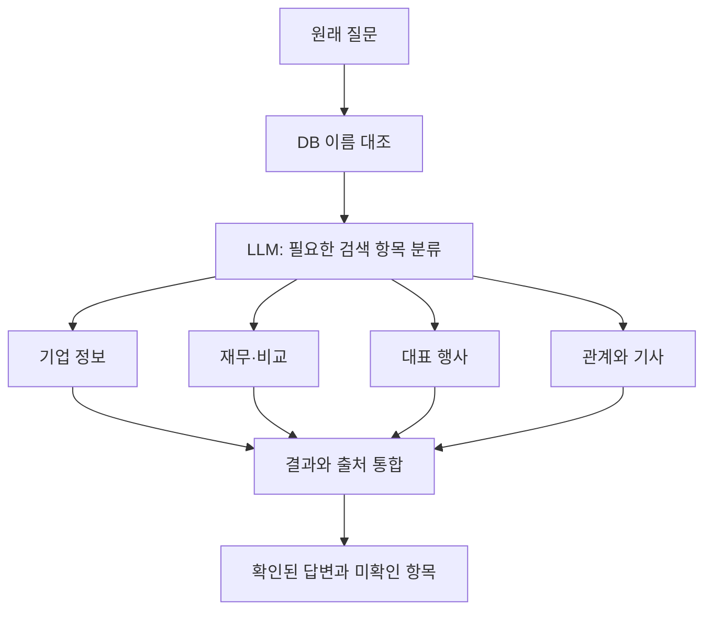

모델은 허용된 항목만 고르며 DB 이름과 직접 대조된 대상만 검색합니다. 수치·기간·역할은
질문에서 확인하고, 2025년 연간 개별 재무의 기존 제한은 유지합니다. 확인되지 않은 연도,
비율, 수치나 직책을 대신 만들어 검색하지 않습니다. 서로 다른 연도가 함께 있는 행사 요청은
연도 귀속이 불명확할 수 있어 기존 경로로 되돌립니다. 이름 인식 및 일부 안전 검사는 아직
명시 표현에 의존하며, 범위가 복잡한 질문을 모두 조합할 수 있는 것은 아닙니다.
각 작업의 추가 근거 검색·답변 생성에 LLM 호출이 발생할 수 있습니다. Neo4j 쓰기와 배포는 없습니다.

## 로컬 질문 분석 개선 (2026-11-09)

단일 기업의 일반 질문은 이름을 DB에서 먼저 확인한 뒤 `plan_question`에서 LLM이
회사 소개 요청 여부와 관계·기사 맥락 필요 여부를 구조화해 반환합니다. 소개가 포함되면
출처가 있는 `BulsaeCompanyInfo.main_business`를 먼저 조회하고, 기존 `enrich` 단계에서
관련 그래프와 원문을 검색합니다. 소개와 전략을 함께 요청한 경우에도 같은 흐름을 사용합니다.
관계의 문서 ID로 조회한 기사와 독립 원문 검색은 기존 기준대로 구분합니다.

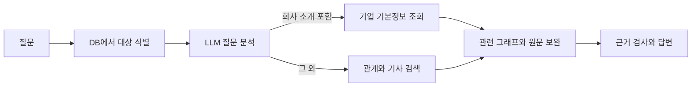

LLM의 출력은 두 개의 불리언으로 제한하며, 기업명·Cypher·사실은 생성하지 않습니다.
실패하거나 형식이 잘못되면 기존 표현 기반 규칙으로 되돌아갑니다. 소개 자료가 없으면
일반 근거를 찾아보며 없는 회사정보를 만들어내지 않습니다. 이름 식별은 여전히 DB 이름
대조 방식이고, 재무·비교·대표 행사 질문은 기존 전용 경로를 유지합니다. 따라서 모든
복합 질문을 자유롭게 조합하는 범용 검색 계획기는 아닙니다. 질문 분석은 API 호출 1회가
추가될 수 있고, 분석 계획은 실행 기록에만 남으며 Neo4j 스키마를 변경하지 않습니다.
이 변경은 로컬에서만 작업합니다.

## 단순 질문과 관련 분석을 함께 제공하는 현재 흐름 (2026-11-09)

원래 질문에 먼저 답한 뒤, 같은 대상·기간·주제를 이해하는 데 필요한 관련 자료를
자동으로 검색합니다. 질문 자체를 바꾸거나 사용자에게 후속 질문을 제안하지 않습니다.

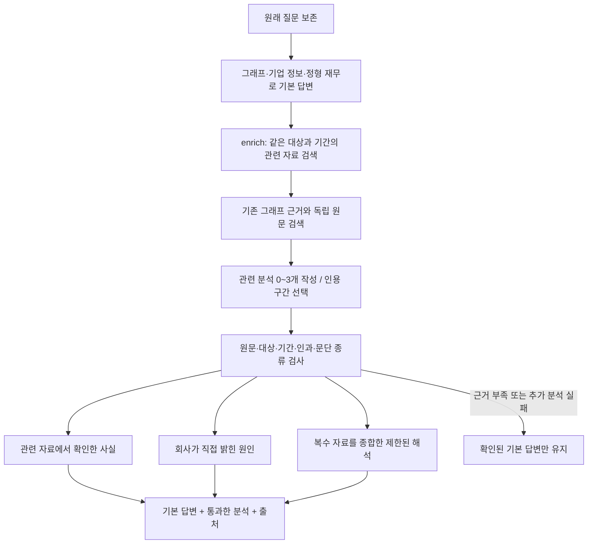

| 구분 | 표시 기준 |
|---|---|
| 기본 답변 | 원래 질문의 직접 답. 재무 금액은 정형 자료의 연간 개별 기준 유지 |
| 관련 자료에서 확인한 사실 | 기사·공시에 직접 서술된 관련 사업, 활동, 계획 등 |
| 회사가 밝힌 원인 | 회사나 명시된 회사 관계자가 해당 결과의 원인이라고 직접 설명한 근거. 기자·분석가 의견은 제외 |
| 자료를 종합한 해석 | 서로 다른 문서 둘 이상의 확인된 전제를 연결한 제한된 해석. 복제 기사만으로 만들지 않으며 회사의 주장처럼 표현하지 않음 |

- `graphs.py`의 공통 `enrich` 노드에서 `QueryDeps.documents`, `search`, `related`를 사용합니다.
- `question`은 유지합니다. 확장 검색문은 `related_search_query`에만 기록합니다.
- 답변 상태에 `basic_answer`, `related_points`, `related_evidence`, `related_status`를 추가했습니다. DB 필드가 아닙니다.
- `related_analysis.py`가 문단 종류와 인용 ID를 생성하고 코드가 실제 원문을 복원합니다. 의미 검사는 별도 LLM 호출로 수행합니다.
- 근거가 충분한 경우에만 최대 3개 항목을 추가합니다. 회사 설명이나 종합 해석이 없으면 해당 항목을 생략합니다.
- 제목의 연도나 기사 발행일만으로 질문 기간의 사실이라고 판정하지 않습니다. 기간이 명시된 질문은 발췌문 안에서도 해당 연도가 확인되는 자료로 제한합니다.
- 금융 금액·증감률은 추가 분석에서 반복하지 않습니다. 그룹·연결 사업 배경은 개별 재무의 원인으로 단정하지 않습니다.
- 원문 검색은 키워드 기반의 제한된 검색입니다. 모든 자료를 찾거나 자동 의미 검사가 모든 오류를 잡는다는 보장은 없습니다.
- 추가 분석 실패 시 기본 답변을 유지합니다. 오류 상세와 분석 상태는 품질 기록에 남깁니다.
- 추가 검색이 실패하면 기본 답변 단계에서 원문 확인을 마친 근거도 재사용합니다. 오류는 단계 이름과 예외 유형만 `related_errors`에 기록하며, 접속 정보가 포함될 수 있는 예외 메시지는 저장하지 않습니다.
- 추가 문단의 의미 검사에는 `relevant_to_question`이 필수입니다. 같은 기업을 언급하는 것만으로는 통과하지 않습니다. 종합 해석은 `distinct_premises`도 통과해야 하며, 같은 URL이나 동일·유사 인용을 두 문서로 세지 않습니다. 유사도 검사는 복제 근거를 줄이는 보조 검사이며 독립성의 완전한 증명은 아닙니다.
- Streamlit은 기본 답변 다음에 ‘관련 자료로 더 살펴본 내용’을 한 번 표시하고, 각 항목에 보도 사실·회사 원인·종합 해석 구분과 출처를 유지합니다. 추가 항목이 없으면 빈 분석 영역을 만들지 않습니다.
- Streamlit과 로컬 HTTP 화면에서 답변 뒤 추천 질문을 제거했습니다. 입력 전 시작 예시만 유지합니다.
- 웹 서비스와 `langgraph-question` / `langgraph-ask`가 동일한 추가 분석 의존성을 연결합니다. DB 쓰기는 없습니다.
- 기본 답변 외에 최대 2회의 OpenAI 호출(추가 분석 생성·검사)이 추가됩니다. 근거가 없으면 호출을 생략합니다.

### 골든셋 실행에서 보완한 분기와 검사

- 둘 이상의 기업을 명시한 공동 사업·공급 질문은 대상 불명으로 막지 않고 함께 검색합니다. 기업별 수치 비교와 기업 간 연결 질문을 구분합니다.
- “앞으로 키울 사업”은 회사 소개 대신 뉴스·전략 검색으로 보냅니다.
- 법인 재무와 그룹 전략을 결합할 때 법인별 2025년 연간 개별 금액은 정형 자료에서, 그룹 전략은 별도 기사에서 읽습니다. 질문 원문은 보존합니다.
- 분기·연결·그룹 재무 질문은 기사 검색 경로를 사용합니다. 연간 개별 금액으로 대체하지 않습니다. 검색 범위 안에서 확인하지 못한 정보는 보류합니다.
- 원문 검색은 기업명 내부 공백을 허용하고, 질문의 정원·대학·공급·이슈·전략 같은 주제 및 분기별 자료를 우선합니다.
- 기본 답변에도 `reported_fact` / `company_explanation`을 구분합니다. 계획 발표만으로 “회사가 밝힌 원인”을 붙이지 않습니다. 원인·결과·발언 귀속 검사와 별도 의미 검사를 함께 적용합니다.
- 웹/Streamlit 기본 생성 모델은 `BULSAE_LLM_MODEL`(기본 `gpt-4.1`), 답변 검증 모델은 `BULSAE_REVIEW_MODEL`(기본 `gpt-4.1`)입니다. 검증 모델도 오류 가능성이 있으므로 골든셋 결과를 별도로 기록합니다.
- 추가 분석은 기본 답변과의 의미 중복 검사에 더해 문자 구간 유사도 검사를 적용합니다. 날짜·제품·회사 범위를 혼동한 문단은 제외합니다.

#### 실제 골든셋 검증 결과 (2026-11-09)

현재 문서의 26문항을 기대답변 변경 없이 실행하고 수정 후 재시험했습니다.
최종 선택 응답은 26건 모두 생성되었지만, 핵심 답변 확인 9건·부분 충족 12건·보완 필요 5건으로 기록했습니다.
추가 문단은 16문항에서 나왔습니다. 회사 원인 설명과 자료 종합 해석의 양성 사례는 최종 응답에 없으므로,
해당 구분이 실제 질문에서 충분히 작동한다고 결론 내릴 수 없습니다.

뉴스 57개 문서에서 인용 159개를 DB 원문과 대조했으며 불일치는 없었습니다. 이는 인용 존재 검사이며,
답변 전체의 정확성이나 누락 없음 검증이 아닙니다. 자동 회귀 검사 108개는 통과했습니다.
분기 실적과 전략을 함께 묻는 질문, 해외 목표, 파트너 역할 비교의 검색 누락이 남아 있습니다.
마지막 이슈 추가 문단 필터는 단위 검사만 마쳤습니다. 이번 작업에서 공개 사이트를 재배포하지 않았습니다.

재현 실행 도구는 `tests/run_live_golden.py`입니다. 실제 응답·기대답변·근거와 검토표는
Git에서 제외된 `private_data/golden_live_20261109/`에 보존합니다. 팀원 데이터 및 DB 노드·관계는 변경하지 않았습니다.
- 품질 기록의 문단에는 `kind`와 기본/추가 구분 `section_type`이 있습니다. `joint_query` 역시 질의 상태 필드이며 DB 변경은 없습니다.

아래는 이전 구현 및 초기 설계 기록입니다. 현재 변경은 위 흐름을 기준으로 합니다.


## 현재 질의 흐름 구현 (2026-11-08)

아래 기존 가이드는 초기 설계 초안입니다. 현재 뉴스 원문 기반 지식그래프에
연결한 첫 질의 흐름은 `src/bulsae/graphrag/graphs.py`에 있습니다.

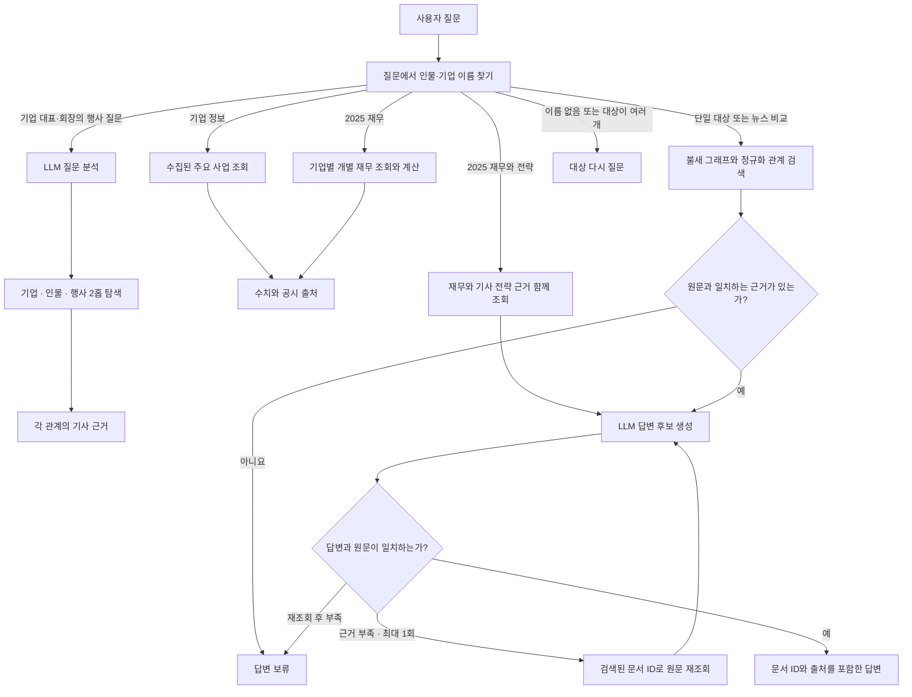

- 질문에 적힌 이름을 기존 불새 인물·기업 노드와 비교해 대상을 찾습니다. 이름이
  없거나 대상이 모호하면 다시 물어봅니다. 기업 2~4곳의 비교를 지원합니다. 이름 추출에는 LLM 호출을
  사용하지 않고 저장된 이름·법인명을 이용합니다. 검색은 Neo4j 읽기 전용이며
  `B_` 라벨은 제외합니다. 문서 기반 관계와 `NORMALIZED_AS` 연결을 조회합니다.
- 원문 대조에 실패한 근거를 제외합니다. LLM이 답변으로 고른 문장은 원문에 실제로
  있는 문장만 허용하고 별도 LLM으로 질문에 맞는지 검토합니다. 자동 검토가 사실을 보증하지는 않습니다.
- 여러 기업의 2025년 연간 개별 매출액·영업이익 비교는 정형 재무와 공시 출처를
  읽어 코드로 계산합니다. 다른 연도·분기·연결재무·전년 대비는 보류합니다.
  뉴스 비교는 기업별 기사 근거를 따로 모으며 한쪽 근거가 부족하면 비교를 보류합니다.
- 단일 기업 주요 사업과 2025년 재무를 조회하며, 2025년 재무와 그해 보도된 전략을
  함께 찾는 실험 경로가 있습니다. 기사 발행일은 전략 발표일을 보장하지 않습니다.
- 기업의 대표·회장이 참석한 행사 질문은 LLM으로 의도를 분석하고
  `기업 ← WORKS_AT ← 인물 → PARTICIPATED_IN → 행사`의 2홉을 탐색합니다.
  직책과 참여가 같은 원문 기사에서 확인되고, 명시 연도가 행사명에 나타나는 후보만 표시합니다.
  이 기능이 모든 유형의 다중 홉 검색을 지원하는 것은 아닙니다.
- 답변 근거가 부족하면 검색된 문서 ID의 원문을 다시 조회해 최대 한 번 재생성합니다.
  벡터 검색 결합, 다른 질문 유형의 LLM 분석과 체크포인터는 아직 연결하지 않았습니다.
- 관계 자동 점검에서 원문 위치가 다르거나 관계 표현이 불명확한 후보는 별도 검토로
  표시하며, 해당 관계와 이에 의존한 정규화 연결은 기본 검색에서 제외합니다.
- `QueryDeps`로 검색·생성·검토 기능을 주입합니다. State에는 연결 객체나 API 키를 넣지 않습니다.

실행은 프로젝트 루트에서 다음과 같이 합니다. 원문 재조회가 필요하면 답변 생성·검토가
최대 한 번 반복되어 OpenAI API 호출이 추가될 수 있습니다. 재무 수치 조회·비교는
OpenAI를 호출하지 않습니다.

```bash
uv run python -m bulsae.graphrag.pipeline langgraph-question '김승환 아모레퍼시픽 대표가 참석한 행사는?' --limit 200
uv run python -m bulsae.graphrag.pipeline langgraph-question '아모레퍼시픽과 이니스프리의 2025년 매출과 영업이익을 비교해줘'
uv run python -m bulsae.graphrag.pipeline langgraph-question '아모레퍼시픽의 2025년 매출액과 그해 보도된 성장 전략을 알려줘'
uv run python -m bulsae.graphrag.pipeline langgraph-question '아모레퍼시픽의 대표이사가 2026년에 참석한 행사는 무엇인가요?'
```

**설계 결정:** 원문 기반 그래프와 기존 파일럿의 데이터 구조가 달라서 기존 `ask`를
바꾸지 않고 `langgraph-ask`를 추가했습니다. 실제 불새 데이터로 근거와 흐름을
확인한 뒤 질문 해석·검색 확장·재시도를 별도 단계로 설계합니다.

담당: 안나 · 기준일: 2026-11-06

이 문서는 GraphRAG의 처리 흐름을 LangGraph로 어떻게 설계하는지, 왜 그렇게 나누는지, 이후 기능을 어떻게 추가할지 설명합니다. 코드를 따라 치는 문서가 아니라 **설계 판단을 이해하고 직접 바꿀 수 있게 하는 문서**입니다.

Mermaid 그림은 GitHub와 VS Code의 Markdown 미리보기에서 볼 수 있습니다. VS Code에서는 Mermaid 미리보기 확장이 필요할 수 있습니다.

| 부분 | 내용 |
|---|---|
| 1~2장 | 왜 LangGraph를 쓰는지, 핵심 개념 |
| 3장 | 그래프를 설계하는 순서 |
| 4~6장 | 이 프로젝트의 설계와 이유 |
| 7장 | 기존 코드에서 옮기는 순서 |
| 8~9장 | 개선과 추가 작업 방법 |
| 부록 | 테스트를 통과한 기준 코드 |

## 1. 왜 LangGraph를 쓰는가

현재 `pipeline.py`는 명령을 하나씩 실행합니다. 소량 실험에는 충분합니다. 하지만 규모가 커지면 흐름 자체를 다뤄야 하는 문제가 생깁니다.

| 지금 생기는 문제 | 현재 방식 | LangGraph 사용 시 |
|---|---|---|
| 추출 중 오류로 멈춤 | 새 출력 파일로 처음부터 다시 실행 | 체크포인트에서 이어서 실행 |
| 검토 전에 적재되면 안 됨 | 사람이 순서를 기억해 명령 실행 | 승인 단계에서 그래프가 멈춤 |
| 근거가 부족한 질문 | 약한 근거로도 답변 생성 | 조건에 따라 재검색 또는 답변 거절 |
| 잘못된 출처가 답변에 포함 | 사람이 읽고 찾아야 함 | 인용 검사 후 다시 생성 |
| 흐름 설명과 코드가 따로 놂 | 문서를 따로 관리 | 코드에서 구조 그림을 뽑을 수 있음 |

단계가 일직선이고 분기, 재시도, 사람 개입이 없다면 LangGraph가 필요 없습니다. 그래서 `prepare.py`의 청크 생성처럼 한 번에 끝나는 일은 그래프로 만들지 않습니다.

**LangGraph는 추출 품질이나 검색 정확도를 높여 주지 않습니다.** 흐름을 통제할 뿐입니다. 품질은 프롬프트, 데이터, 그래프 모델, 평가에서 결정됩니다.

## 2. 핵심 개념

| 개념 | 뜻 | 이 프로젝트의 예 |
|---|---|---|
| State | 노드들이 함께 보는 작업 메모 | 질문, 찾은 근거, 답변 |
| Node | 한 가지 일을 하는 함수. 바꿀 State 값만 돌려줌 | `retrieve`, `generate` |
| Edge | 다음에 실행할 노드 | `load_facts` 다음은 `generate` |
| Conditional edge | State를 보고 다음 노드를 고르는 분기 | 점수가 낮으면 `rewrite` |
| Checkpointer | 단계마다 State를 저장하는 장치 | 추출 도중 멈춰도 이어서 실행 |
| Interrupt | 그래프를 멈추고 사람의 입력을 기다림 | 적재 전 승인 |

노드는 이렇게 생겼습니다. State를 받고, 바뀐 값만 돌려줍니다.

```python
def rewrite(state):
    return {"search_query": deps.rewrite(state["question"]),
            "rewrites": state.get("rewrites", 0) + 1}
```

분기 함수는 일을 하지 않고 **다음 노드의 이름만 돌려줍니다.**

```python
def after_check(state):
    if state["citations_ok"]:
        return END
    return "generate" if state["generations"] < MAX_GENERATIONS else "abstain"
```

## 3. 그래프를 설계하는 순서

코드부터 쓰지 않습니다. 새로운 기능을 추가할 때도 이 순서를 그대로 따릅니다.

### 1단계. 일직선 흐름을 적는다

```text
질문 → 검색 → 답변 생성
```

### 2단계. 실패와 판단 지점을 찾는다

단계마다 묻습니다. **실패하면 어떻게 되나? 사람이 봐야 하나? 결과가 나쁘면 어떻게 아나?**

| 단계 | 실패나 판단 | 대응 |
|---|---|---|
| 검색 | 관련 근거가 없음 | 재검색 또는 거절 |
| 답변 생성 | 검색하지 않은 문서를 인용 | 다시 생성 또는 거절 |

이 지점이 없으면 그래프가 아니라 함수로 충분합니다.

### 3단계. 상태를 정한다

**분기에 필요한 값과 다음 노드에 넘길 값만 넣습니다.** API 클라이언트, DB 연결, 비밀값, 임베딩 벡터는 넣지 않습니다. State는 체크포인트에 저장되기 때문입니다.

### 4단계. 노드 경계를 나눈다

아래 중 하나라도 해당하면 별도 노드로 나눕니다.

- 비용이 드는 호출이라 다시 실행하면 안 된다
- 이 지점에서 재시도하거나 멈춰야 한다
- 앞의 결과에 따라 실행 여부가 달라진다
- 혼자 테스트할 가치가 있다

해당하지 않으면 노드를 늘리지 않습니다. 함수 호출로 충분합니다.

### 5단계. 끝나는 것을 보장한다

되돌아가는 선이 있으면 **반드시 횟수 제한**을 둡니다. 없으면 비용이 끝없이 나갈 수 있습니다. 모든 경로가 종료 또는 거절로 이어지는지 그림에서 확인합니다.

### 6단계. 가짜 연결로 흐름을 테스트한다

OpenAI나 Neo4j 없이 분기만 검증합니다. 그래서 외부 연결을 `deps`로 받습니다. 비용 없이 초 단위로 끝납니다.

### 7단계. 그림과 코드를 맞춘다

코드에서 구조를 뽑아 이 문서의 그림과 비교합니다.

```python
print(graph.get_graph().draw_mermaid())
```

## 4. 전체 아키텍처

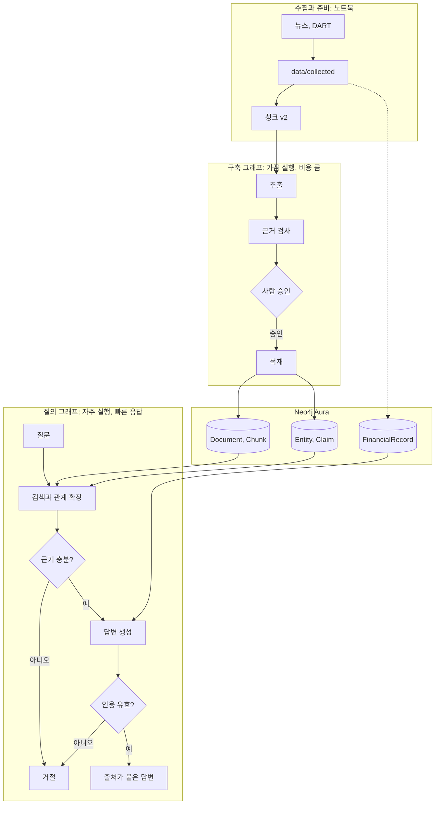

### 왜 그래프를 두 개로 나누나

| 기준 | 구축 그래프 | 질의 그래프 |
|---|---|---|
| 실행 빈도 | 데이터를 늘릴 때 | 질문할 때마다 |
| 실행 시간 | 몇 분에서 몇 시간 | 몇 초 |
| 사람 개입 | 적재 전 승인 | 없음 |
| 체크포인트 | 필수 | 필요 없음 |
| 실패 대응 | 이어서 실행 | 다시 묻거나 거절 |

성격이 달라서 한 그래프에 넣으면 분기만 복잡해집니다. 둘의 접점은 Neo4j 데이터뿐입니다.

### 데이터 모델

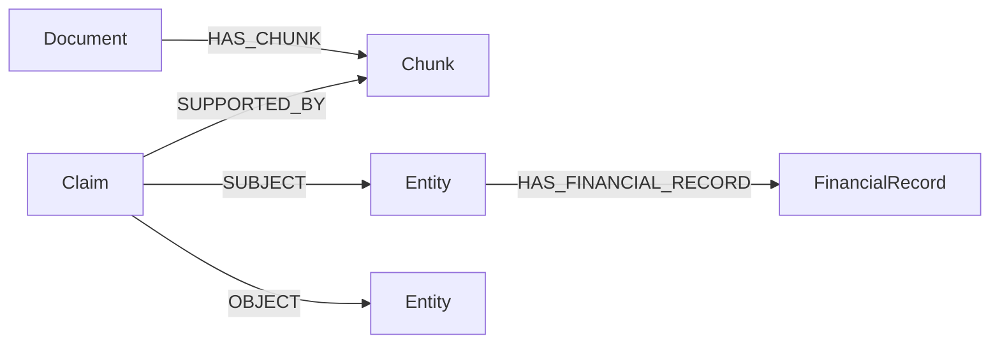

관계를 Entity 사이의 선으로 바로 잇지 않고 `Claim` 노드로 두었습니다. 관계마다 근거 문장, 상태, 검토 여부를 붙이고 원문까지 추적하기 위해서입니다.

## 5. 구축 그래프


| 노드 | 하는 일 | 쓰는 기존 코드 | 분리한 이유 |
|---|---|---|---|
| `read_batch` | 청크 일부 읽기 | `read_jsonl` | 묶음 단위로 승인하고 이어서 실행 |
| `extract` | 실패한 청크만 추출 | `extract_chunk` | 비용이 들고 재시도 지점 |
| `save_review` | 검토 파일 저장 | 새로 작성 | 부작용을 승인 대기와 분리 |
| `review` | 사람 결정 대기 | 없음 | 그래프를 멈출 지점 |
| `load` | 임베딩과 적재 | `run_load`의 반복문 내부 | 승인 후에만 실행 |

### 왜 이렇게 만드나

**묶음(batch)으로 처리합니다.** 청크 12,309개를 한 번에 추출하고 나서 잘못된 것을 알면 비용을 버립니다. 작게 나눠 승인하면 문제를 초기에 발견합니다.

**재시도는 실패한 청크만 합니다.** 성공한 청크를 다시 호출하면 비용이 이중으로 듭니다. `extract`가 오류를 잡아 `failed`에 모으는 이유입니다. 묶음 전체를 예외로 끝내면 성공한 결과까지 잃습니다.

**실패 청크는 건너뛰고 기록합니다.** 2회 실패한 청크는 오류 내용과 함께 승인 화면과 검토 파일에 나오고, 승인 후 `unprocessed`에 쌓입니다. 한 청크 때문에 전체가 멈추지 않게 하면서, 빠진 청크를 나중에 찾을 수 있게 하기 위해서입니다. 재처리는 `unprocessed`의 청크로 새 실행을 시작합니다.

**재시도와 장애 복구는 다릅니다.** API 오류처럼 코드가 잡는 실패는 위 재시도로 처리합니다. 프로그램이 강제로 종료되면 다릅니다. 체크포인트는 노드가 끝날 때 저장되므로, `extract` 도중 꺼지면 그 묶음을 처음부터 다시 호출합니다. 묶음을 작게 두면 다시 내는 비용이 그 묶음으로 제한됩니다. 이 비용이 문제가 될 만큼 묶음을 키워야 한다면 청크별 노드나 진행 기록을 검토합니다.

**`review` 노드에서는 interrupt만 합니다.** LangGraph는 재개할 때 **그 노드를 처음부터 다시 실행**합니다. 같은 노드에 파일 저장이나 API 호출이 있으면 재개할 때 또 실행됩니다. 그래서 `save_review`를 앞에 따로 둡니다. 이 규칙은 interrupt를 쓰는 모든 곳에 적용합니다.

**승인과 사실 검증은 다릅니다.** 승인은 "이 묶음을 그래프에 넣어도 된다"는 뜻입니다. 각 `Claim`의 `review_status`는 계속 `unreviewed`로 둡니다. 개별 판정 결과만 나중에 이 값을 바꿉니다.

**체크포인트는 `private_data/`에 둡니다.** State에 기사 본문이 포함된 청크가 들어가므로 체크포인트 DB에도 본문이 저장됩니다.

## 6. 질의 그래프


| 노드 | 하는 일 | 쓰는 기존 코드 | 분리한 이유 |
|---|---|---|---|
| `retrieve` | 청크 검색과 관계 확장 | `run_ask`의 첫 쿼리 | 재시도 지점, 검색 방식을 바꿀 수 있음 |
| `rewrite` | 검색어 재작성 | 새로 작성 | 근거가 약할 때만 실행 |
| `load_facts` | 기업, 재무 조회 | `run_ask`의 둘째 쿼리 | 근거가 충분할 때만 실행 |
| `generate` | 답변 생성 | `run_ask`의 `response_text` 호출 | 비용, 재시도 지점 |
| `check_citations` | 인용 문서 ID 검사 | 새로 작성 | 비용 없는 품질 관문 |
| `abstain` | 답변 거절 | 새로 작성 | 모든 실패가 모이는 끝 |

### 왜 이렇게 만드나

**인용 검사는 AI가 아니라 규칙으로 합니다.** 답변에 나온 `NEWS-...` 전부가 검색한 문서에 있는지만 봅니다. 하나라도 없으면 실패입니다. 비용이 없고 결과가 항상 같고 테스트하기 쉽습니다. 이것으로 "검색 안 한 문서 인용"은 막지만 "문서를 읽고 잘못 해석"은 막지 못합니다. 그 평가는 대표 질문과 사람 검토로 합니다.

**재작성은 1회, 생성은 최대 2회입니다.** 질의는 응답 시간과 비용이 중요합니다. 한 번 고쳐서 안 되는 문제는 대부분 데이터에 근거가 없는 경우입니다.

**근거가 없으면 답하지 않습니다.** 없는 답을 만드는 것보다 "답할 수 없다"가 낫습니다. 이 프로젝트의 핵심 가치는 답변의 근거입니다.

**`MIN_SCORE = 0.3`은 임시값입니다.** 측정으로 정한 값이 아닙니다. 대표 질문과 관련 없는 질문의 점수를 비교해 정합니다.

**LangGraph의 메시지 상태나 에이전트 도구 호출을 쓰지 않습니다.** 흐름이 고정되어 있어 필요 없습니다. AI가 다음 단계를 스스로 고르게 하면 비용과 결과 예측이 어려워지고 비교 평가도 어려워집니다.

## 7. 기존 코드에서 옮기는 순서

**새 파이프라인을 만드는 것이 아닙니다.** `pipeline.py`의 함수를 재사용하고, 기존 CLI는 남겨 둡니다. 시작 시점은 S2-2의 소량 추출과 S2-3의 검토가 CLI로 동작한 뒤입니다.

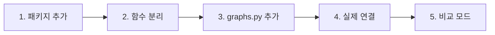

### 1단계. 패키지 추가

```bash
git checkout -b anna/langgraph
uv add 'langgraph>=1.2.20,<2' 'langgraph-checkpoint-sqlite>=3.1.3'
```

### 2단계. 함수 분리

동작을 바꾸지 말고 `pipeline.py`에서 함수만 꺼냅니다. 기존 테스트가 그대로 통과해야 합니다.

| 새 함수 | 꺼낼 위치 | 포함 범위 | 반환 |
|---|---|---|---|
| `ensure_schema(db)` | `run_load`의 `for` 앞 | 제약 조건, 벡터 인덱스 생성 | 없음 |
| `load_record(db, record)` | `run_load`의 `for` 내부 | `graph_rows`, 임베딩, 적재 쿼리 | `Claim` 수 |
| `search_evidence(db, text, limit)` | `run_ask`의 첫 쿼리 | `embedding` 호출, 쿼리, `r.data()` 변환 | dict 목록 |
| `company_facts(db)` | `run_ask`의 둘째 쿼리 | 쿼리, `r.data()` 변환 | dict 목록 |
| `answer(question, evidence, facts, model)` | `run_ask`의 프롬프트 부분 | 프롬프트 조립, `response_text` | 답변 문자열 |

분리 후 `run_load`, `run_ask`는 이 함수들을 호출하도록 고칩니다. `ensure_schema`는 묶음마다 부르지 않고 실행을 시작할 때 한 번 호출합니다.

### 3단계. `graphs.py` 추가

부록의 `src/bulsae/graphrag/graphs.py`와 `tests/test_graphrag_graphs.py`를 추가하고 테스트합니다. 이 단계는 비용이 들지 않습니다.

```bash
uv run python -m unittest discover -s tests
```

### 4단계. 실제 연결

`pipeline.py`에 새 명령 `index-graph`, `ask-graph`를 추가합니다. 연결부 예시입니다. 실제 DB로 실행한 코드는 아니므로 소량으로 확인합니다.

```python
from itertools import islice
from langgraph.checkpoint.sqlite import SqliteSaver
from langgraph.types import Command
from bulsae.graphrag import graphs


def read_batch(path, batch, size):
    return list(islice(read_jsonl(path), batch * size, (batch + 1) * size))


def query_deps(db, model, limit):
    return graphs.QueryDeps(
        search=lambda text: search_evidence(db, text, limit),
        company_facts=lambda: company_facts(db),
        rewrite=lambda question: response_text({"model": model, "store": False,
            "input": "다음 질문을 뉴스 검색에 맞는 짧은 검색어로 바꿔라. 검색어만 출력하라.\n" + question}),
        generate=lambda question, evidence, facts: answer(question, evidence, facts, model))
```

구축 그래프의 연결입니다. 레코드에는 추출 때 쓴 모델명이 함께 저장되므로 `load_record`의 `record["model"]`을 그대로 쓸 수 있습니다.

```python
def index_deps(db, path, size, model, run_name):
    def save_review(batch, records, errors):
        output = Path(f"private_data/{run_name}_review_{batch}.jsonl")
        with output.open("x", encoding="utf-8") as file:
            for record in records:
                file.write(json.dumps(record, ensure_ascii=False) + "\n")
            for chunk_id, error in errors.items():
                file.write(json.dumps({"failed_chunk": chunk_id, "error": error},
                                      ensure_ascii=False) + "\n")
        return str(output)

    def load_records(records):
        for record in records:
            load_record(db, record)
        return len(records)

    return graphs.IndexDeps(
        model=model,
        read_batch=lambda batch: read_batch(path, batch, size),
        extract=lambda chunk: extract_chunk(chunk, model),
        save_review=save_review, load_records=load_records)
```

구축 그래프는 체크포인트와 실행 이름을 지정합니다.

```python
with SqliteSaver.from_conn_string("private_data/index_checkpoints.sqlite") as saver:
    graph = graphs.build_index_graph(deps, saver)
    config = {"configurable": {"thread_id": args.run_name}}
    result = graph.invoke({}, config)                      # 첫 실행
    result = graph.invoke(Command(resume="approve"), config)  # 승인 후 재개
```

재개는 별도 명령으로 분리합니다. 첫 실행 뒤 프로그램을 끝내고 검토 파일을 본 다음, 같은 `run_name`으로 다시 실행하면 멈춘 곳에서 이어집니다.

**재개할 때는 입력 파일, 묶음 크기, 모델이 처음과 같아야 합니다.** 묶음을 `batch * size` 위치로 읽기 때문에 크기가 바뀌면 청크가 빠지거나 겹칩니다. 첫 실행 때 설정을 저장하고 재개할 때 비교합니다.

```python
settings = {"input": str(args.chunks), "batch_size": args.batch_size, "model": args.model}
path = Path(f"private_data/{args.run_name}_settings.json")
if path.exists():
    if json.loads(path.read_text(encoding="utf-8")) != settings:
        raise ValueError("재개 설정이 첫 실행과 다릅니다. 새 run_name을 쓰세요.")
else:
    path.write_text(json.dumps(settings, ensure_ascii=False), encoding="utf-8")
```

처음에는 묶음 크기 5로 시작합니다. 비용이 드는 명령이므로 실행 전 대상 청크 수를 확인합니다.

### 5단계. 비교 모드

S3-1의 일반 검색 비교에 사용합니다. 질의 그래프는 외부 연결을 `deps`로 받으므로 **같은 그래프에서 검색 함수만 바꿉니다.** 구조화 자료, 재작성, 답변 생성은 양쪽이 같습니다.

```python
vector_deps = graphs.QueryDeps(
    search=lambda text: search_chunks_only(db, text, limit),  # 관계 확장 없음
    company_facts=base.company_facts,
    rewrite=base.rewrite, generate=base.generate)
```

`search_chunks_only`는 `search_evidence`에서 `claims`, `related`를 빼고 벡터 검색만 수행합니다. 이렇게 하면 두 방식의 차이가 검색 방법에서만 나옵니다. `ask-graph`에 `--mode vector|graph` 옵션을 둡니다.

## 8. 설계 결정 기록

중요한 결정은 아래 표에 남깁니다. 나중에 왜 이렇게 했는지 찾지 않아도 되고, 언제 바꿔도 되는지 알 수 있습니다.

| 결정 | 이유 | 고려한 대안 | 다시 검토할 조건 |
|---|---|---|---|
| 그래프 2개로 분리 | 실행 주기, 비용, 사람 개입이 다름 | 그래프 1개 | 두 흐름이 실시간으로 연결될 때 |
| 묶음 단위 승인 | 초기 오류 발견, 비용 통제 | 청크별 승인 | 승인 부담이 커지고 품질이 안정될 때 |
| 2회 실패 청크는 건너뛰고 기록 | 한 건 때문에 전체를 멈추지 않음 | 실패 시 전체 중단 | 실패가 묶음의 상당 부분을 차지할 때 |
| 외부 연결을 `deps`로 주입 | 비용 없는 테스트, 비교 모드 | 노드에서 직접 호출 | 없음 |
| 규칙 기반 인용 검사 | 비용 없음, 결과 일정 | LLM 평가 | 잘못된 해석이 주요 오류로 측정될 때 |
| 재작성 1회, 생성 2회 제한 | 응답 시간, 비용 | 무제한 반복 | 측정 결과 추가 시도가 효과 있을 때 |
| 고정된 흐름 | 예측 가능, 평가 쉬움 | 에이전트 도구 호출 | 질문 유형별로 필요한 도구가 크게 다를 때 |
| 체크포인트 SQLite | 파일 하나, 설치 간단 | Postgres | 여러 프로세스가 동시에 실행할 때 |

## 9. 개선과 추가 작업 방법

### 접근 순서

기능부터 추가하지 않습니다. 아래 순서를 따릅니다.

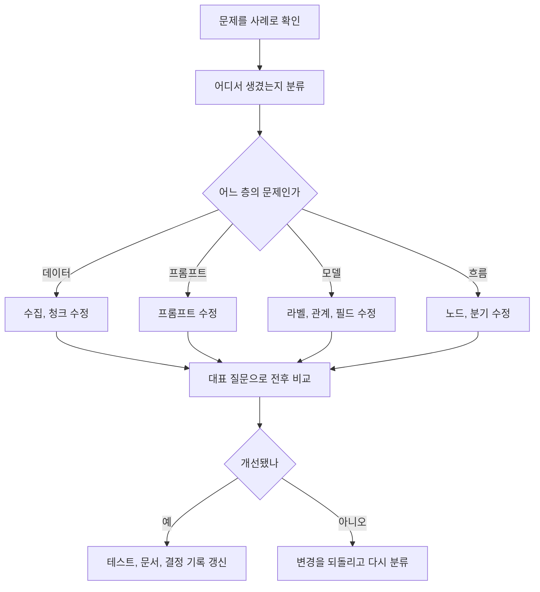

1. **문제를 사례로 적습니다.** "검색이 안 좋다"가 아니라 어떤 질문에서 어떤 문서가 빠졌는지 적습니다.
2. **전후를 비교할 기준을 정합니다.** 성현의 `question_evidence.csv`로 찾은 근거와 놓친 근거를 셉니다.
3. **가장 작은 변경부터 합니다.** 프롬프트 한 줄로 되면 노드를 추가하지 않습니다.
4. **한 번에 하나만 바꿉니다.** 여러 개를 함께 바꾸면 무엇이 효과가 있었는지 모릅니다.
5. **재적재가 필요한지 먼저 확인합니다.** 관계 종류나 청크가 바뀌면 다시 추출해야 하므로 비용이 큽니다.

### 어디를 고칠까

| 증상 | 먼저 볼 곳 | 고치는 위치 |
|---|---|---|
| 관련 없는 기사가 많음 | 뉴스 판정 결과 | 수집 필터 |
| 인용 거부가 많음 | `rejected`의 사유 | 추출 프롬프트 |
| 잘못된 관계가 많음 | 관계 판정 결과 | 프롬프트, 관계 종류 |
| 같은 회사가 여러 노드 | `Entity` 이름 | `entity_id`, 개체 통합 |
| 검색이 못 찾음 | 검색 점수와 청크 | 청크, 임베딩 텍스트 |
| 근거는 찾았지만 답이 나쁨 | 프롬프트에 들어간 내용 | `answer` 프롬프트 |
| 멈춘 뒤 다시 실행됨 | 노드의 부작용 위치 | 노드 분리 |
| 비용이 큼 | 재시도와 재추출 횟수 | 분기 조건, 묶음 크기 |

### 노드를 추가하는 방법

1. 3장의 질문으로 정말 노드가 필요한지 확인합니다.
2. 필요한 State 필드를 추가합니다.
3. 외부 호출이 있으면 `deps`에 함수를 추가합니다.
4. 노드와 분기를 추가합니다. 되돌아가는 선이면 횟수 제한을 넣습니다.
5. 정상, 실패, 제한 초과를 테스트로 추가합니다.
6. `draw_mermaid()` 결과로 이 문서의 그림을 고칩니다.
7. 체크포인트 형식이 바뀌었다면 진행 중인 실행을 끝내고 새 `thread_id`로 시작합니다.

### 개선 후보

순서대로 할 필요는 없습니다. **시작 조건이 측정됐을 때만** 진행합니다.

| 개선 | 시작 조건 | 접근 방법 | 주의 |
|---|---|---|---|
| 구조화 자료 인용 허용 | 재무 질문이 인용 없음으로 거절됨 | `cited_documents`에 `FINANCIAL-` ID 추가, `facts` ID를 허용 목록에 추가 | 현재 재무만으로 만든 답변은 거절됩니다 |
| 7개사 구조화 적재 | 대표 질문에 다른 기업 재무가 필요 | `run_structured`의 대상 필터 제거 | ID 중복 확인 |
| 개체 통합 | 같은 회사가 나뉘어 관계 탐색이 끊김 | `extract`와 `load` 사이에 `normalize_entities` 노드 추가 | 동명이인 오결합 위험, 재적재 필요 |
| 질문 유형 분기 | 질문 유형별로 필요한 자료가 분명히 다름 | `retrieve` 앞에 `classify` 노드 추가. 규칙부터 시작 | 먼저 대표 질문으로 효과 측정 |
| 공시 문서 추가 | 뉴스로 답하지 못하는 질문이 확인됨 | 공시 본문 청크를 만들어 같은 구축 그래프에 입력 | `document_id` 형식과 출처 유형 구분, 이용 조건 확인 |
| 관계 판정 결과 반영 | 성현의 판정 결과가 쌓임 | `claim_review.csv`를 읽어 `review_status` 갱신. `generate`에서 판정 상태 전달 | 표본 결과를 전체에 일반화하지 않음 |
| 근거 평가 LLM 노드 | 규칙 통과 후 해석 오류가 주요 문제로 측정됨 | `check_citations` 뒤에 평가 노드 추가 | 비용, 응답 시간 증가 |
| 추출 병렬화 | 실행 시간이 실제 문제가 되고 API 한도 여유가 있음 | `Send`로 청크별 작업 분할 | 한도 초과, 실패 모으기 복잡 |
| 답변 스트리밍, 웹 화면 | 데모 요구사항에 있음 | 그래프를 함수로 호출하는 API 추가 | 그래프 구조는 유지 |

### 지금 넣지 않는 것

| 항목 | 이유 |
|---|---|
| 멀티 에이전트 구조 | 고정된 흐름으로 충분합니다 |
| 장기 메모리, 대화 기록 | 한 질문씩 평가하는 단계입니다 |
| 웹 검색 도구 | 저장된 근거 안에서 답하는 것이 목표입니다 |
| 복잡한 재순위 모델 | 측정된 문제가 아직 없습니다 |

## 10. 자주 하는 실수

| 실수 | 왜 문제인가 | 올바른 방법 |
|---|---|---|
| interrupt 앞에 파일 저장이나 API 호출 | 재개할 때 다시 실행됨 | 앞 노드로 분리 |
| 횟수 제한 없는 되돌림 | 비용이 끝없이 나감 | 제한과 거절 경로 |
| State에 벡터나 DB 연결 저장 | 저장 실패, 체크포인트 비대화 | 함수는 `deps`, State에는 값만 |
| 노드 안에서 다음 경로 결정 | 흐름이 숨어 그림과 달라짐 | 분기는 Conditional edge에서 |
| 체크포인트 파일 커밋 | 기사 본문 공개 | `private_data/`에 저장 |
| 같은 `thread_id` 재사용 | 이전 실행에 이어짐 | 실행마다 새 이름 |
| 재개 때 묶음 크기 변경 | 청크 누락이나 중복 | 설정 저장 후 비교 |
| 그래프가 품질을 올린다고 기대 | 흐름만 통제함 | 평가로 원인 분류 |
| 평가 없이 노드 추가 | 복잡도만 늘어남 | 전후 비교 |

## 11. 체크리스트

- [ ] S2의 소량 추출을 CLI로 확인했다
- [ ] 패키지를 추가했다
- [ ] 함수를 분리했고 기존 테스트가 통과한다
- [ ] `graphs.py`와 테스트를 추가했다
- [ ] `index-graph`를 묶음 5로 실행하고 승인 대기에서 멈추는 것을 확인했다
- [ ] 프로그램을 종료한 뒤 같은 실행 이름으로 재개했다
- [ ] 거절하면 적재되지 않는 것을 확인했다
- [ ] 실패 청크가 검토 파일과 `unprocessed`에 남는 것을 확인했다
- [ ] `ask-graph`가 출처가 붙은 답변을 낸다
- [ ] 관계없는 질문에서 답변을 거절한다
- [ ] `--mode vector`와 `--mode graph`를 비교했다
- [ ] `MIN_SCORE`를 측정값으로 바꿨다
- [ ] `draw_mermaid()` 결과와 문서 그림이 같다

## 부록 A. 기준 코드

`src/bulsae/graphrag/graphs.py`입니다. 아래 코드는 LangGraph 1.2.20에서 부록 B의 테스트를 통과했습니다. 실제 OpenAI와 Neo4j 연결은 포함하지 않았습니다.

```python
"""GraphRAG의 구축과 질의 흐름. 외부 연결은 deps로 받아 테스트에서 바꿔 끼운다."""
import re
from dataclasses import dataclass
from typing import Callable, TypedDict

from langgraph.graph import END, START, StateGraph
from langgraph.types import interrupt

MAX_EXTRACT_ATTEMPTS = 2
MAX_REWRITES = 1
MAX_GENERATIONS = 2
MIN_SCORE = 0.3  # 대표 질문으로 보정한다.
ABSTAIN = "제공된 근거로는 답할 수 없습니다."


@dataclass
class IndexDeps:
    model: str
    read_batch: Callable[[int], list[dict]]
    extract: Callable[[dict], tuple[list, list]]
    save_review: Callable[[int, list[dict], dict], str]
    load_records: Callable[[list[dict]], int]


class IndexState(TypedDict, total=False):
    batch: int
    chunks: list[dict]
    records: list[dict]
    failed: list[dict]
    errors: dict
    unprocessed: list[dict]
    attempts: int
    review_file: str
    decision: str
    loaded: int


def build_index_graph(deps: IndexDeps, checkpointer=None):
    def read_batch(state):
        chunks = deps.read_batch(state.get("batch", 0))
        return {"chunks": chunks, "records": [], "failed": chunks, "errors": {}, "attempts": 0}

    def extract(state):
        records, failed, errors = list(state["records"]), [], {}
        for chunk in state["failed"]:
            try:
                accepted, rejected = deps.extract(chunk)
                records.append({"chunk": chunk, "claims": accepted, "rejected": rejected,
                                "model": deps.model})
            except Exception as error:
                failed.append(chunk)
                errors[chunk["chunk_id"]] = str(error)
        return {"records": records, "failed": failed, "errors": errors,
                "attempts": state["attempts"] + 1}

    def save_review(state):
        return {"review_file": deps.save_review(state.get("batch", 0), state["records"], state["errors"])}

    def review(state):
        decision = interrupt({"batch": state.get("batch", 0), "review_file": state["review_file"],
                              "failed": state["errors"]})
        return {"decision": decision}

    def load(state):
        count = deps.load_records(state["records"])
        skipped = [{"batch": state.get("batch", 0), "chunk_id": chunk_id, "error": error}
                   for chunk_id, error in state["errors"].items()]
        return {"loaded": state.get("loaded", 0) + count, "batch": state.get("batch", 0) + 1,
                "unprocessed": state.get("unprocessed", []) + skipped}

    def after_read(state):
        return "extract" if state["chunks"] else END

    def after_extract(state):
        retry = state["failed"] and state["attempts"] < MAX_EXTRACT_ATTEMPTS
        return "extract" if retry else "save_review"

    def after_review(state):
        return "load" if state["decision"] == "approve" else END

    graph = StateGraph(IndexState)
    for name, node in (("read_batch", read_batch), ("extract", extract),
                       ("save_review", save_review), ("review", review), ("load", load)):
        graph.add_node(name, node)
    graph.add_edge(START, "read_batch")
    graph.add_conditional_edges("read_batch", after_read, ["extract", END])
    graph.add_conditional_edges("extract", after_extract, ["extract", "save_review"])
    graph.add_edge("save_review", "review")
    graph.add_conditional_edges("review", after_review, ["load", END])
    graph.add_edge("load", "read_batch")
    return graph.compile(checkpointer=checkpointer)


@dataclass
class QueryDeps:
    search: Callable[[str], list[dict]]
    company_facts: Callable[[], list[dict]]
    rewrite: Callable[[str], str]
    generate: Callable[[str, list[dict], list[dict]], str]


class QueryState(TypedDict, total=False):
    question: str
    search_query: str
    evidence: list[dict]
    facts: list[dict]
    answer: str
    rewrites: int
    generations: int
    citations_ok: bool


def cited_documents(answer: str) -> set[str]:
    return set(re.findall(r"NEWS-\w+", answer, re.ASCII))


def build_query_graph(deps: QueryDeps):
    def retrieve(state):
        return {"evidence": deps.search(state.get("search_query") or state["question"])}

    def load_facts(state):
        return {"facts": deps.company_facts()}

    def rewrite(state):
        return {"search_query": deps.rewrite(state["question"]), "rewrites": state.get("rewrites", 0) + 1}

    def generate(state):
        answer = deps.generate(state["question"], state["evidence"], state["facts"])
        return {"answer": answer, "generations": state.get("generations", 0) + 1}

    def check_citations(state):
        allowed = {row["document_id"] for row in state["evidence"]}
        for row in state["evidence"]:
            allowed |= {item["document_id"] for item in row.get("related", []) if item.get("document_id")}
        cited = cited_documents(state["answer"])
        return {"citations_ok": bool(cited) and cited <= allowed}

    def abstain(state):
        return {"answer": ABSTAIN}

    def after_retrieve(state):
        if any(row["score"] >= MIN_SCORE for row in state["evidence"]):
            return "load_facts"
        return "rewrite" if state.get("rewrites", 0) < MAX_REWRITES else "abstain"

    def after_check(state):
        if state["citations_ok"]:
            return END
        return "generate" if state["generations"] < MAX_GENERATIONS else "abstain"

    graph = StateGraph(QueryState)
    for name, node in (("retrieve", retrieve), ("rewrite", rewrite), ("load_facts", load_facts),
                       ("generate", generate), ("check_citations", check_citations), ("abstain", abstain)):
        graph.add_node(name, node)
    graph.add_edge(START, "retrieve")
    graph.add_conditional_edges("retrieve", after_retrieve, ["load_facts", "rewrite", "abstain"])
    graph.add_edge("rewrite", "retrieve")
    graph.add_edge("load_facts", "generate")
    graph.add_edge("generate", "check_citations")
    graph.add_conditional_edges("check_citations", after_check, [END, "generate", "abstain"])
    graph.add_edge("abstain", END)
    return graph.compile()
```

## 부록 B. 기준 테스트

`tests/test_graphrag_graphs.py`입니다. 외부 호출 없이 재시도, 실패 기록, 승인, 거절, 재시작 후 재개, 재작성 제한, 인용 검사를 확인합니다.

```python
import tempfile
import unittest
from pathlib import Path

from langgraph.checkpoint.memory import InMemorySaver
from langgraph.checkpoint.sqlite import SqliteSaver
from langgraph.types import Command

from bulsae.graphrag import graphs


class QueryGraphTests(unittest.TestCase):
    def deps(self, search, answers):
        return graphs.QueryDeps(search=search, company_facts=lambda: [],
                                rewrite=lambda question: question + " 재작성",
                                generate=lambda question, evidence, facts: answers.pop(0))

    def test_valid_citation_is_returned(self):
        evidence = [{"document_id": "NEWS-a1", "score": 0.8}]
        graph = graphs.build_query_graph(self.deps(lambda query: evidence, ["답변 NEWS-a1"]))
        self.assertEqual(graph.invoke({"question": "질문"})["answer"], "답변 NEWS-a1")

    def test_weak_search_rewrites_once_then_abstains(self):
        queries = []

        def search(query):
            queries.append(query)
            return [{"document_id": "NEWS-a1", "score": 0.1}]

        graph = graphs.build_query_graph(self.deps(search, []))
        self.assertEqual(graph.invoke({"question": "질문"})["answer"], graphs.ABSTAIN)
        self.assertEqual(queries, ["질문", "질문 재작성"])

    def test_unknown_citation_regenerates_then_abstains(self):
        evidence = [{"document_id": "NEWS-a1", "score": 0.8}]
        graph = graphs.build_query_graph(self.deps(lambda query: evidence, ["NEWS-ff", "근거 없음"]))
        self.assertEqual(graph.invoke({"question": "질문"})["answer"], graphs.ABSTAIN)

    def test_related_document_can_be_cited(self):
        evidence = [{"document_id": "NEWS-a1", "score": 0.8, "related": [{"document_id": "NEWS-b2"}]}]
        graph = graphs.build_query_graph(self.deps(lambda query: evidence, ["답변 NEWS-b2"]))
        self.assertEqual(graph.invoke({"question": "질문"})["answer"], "답변 NEWS-b2")

    def test_any_unknown_id_fails_even_with_valid_id(self):
        evidence = [{"document_id": "NEWS-a1", "score": 0.8}]
        answers = ["NEWS-a1 그리고 NEWS-zzzz", "NEWS-a1 그리고 NEWS-zzzz"]
        graph = graphs.build_query_graph(self.deps(lambda query: evidence, answers))
        self.assertEqual(graph.invoke({"question": "질문"})["answer"], graphs.ABSTAIN)

    def test_korean_particle_after_id_is_valid(self):
        evidence = [{"document_id": "NEWS-a1", "score": 0.8}]
        graph = graphs.build_query_graph(self.deps(lambda query: evidence, ["NEWS-a1에 따르면"]))
        self.assertEqual(graph.invoke({"question": "질문"})["answer"], "NEWS-a1에 따르면")


class IndexGraphTests(unittest.TestCase):
    def build(self, batches, checkpointer=None):
        self.calls = {"c1": 0}
        self.loaded = []

        def extract(chunk):
            self.calls[chunk["chunk_id"]] = self.calls.get(chunk["chunk_id"], 0) + 1
            if chunk["chunk_id"] == "bad":
                raise RuntimeError("계속 실패")
            if chunk["chunk_id"] == "c1" and self.calls["c1"] == 1:
                raise RuntimeError("일시 오류")
            return [{"subject": "A"}], []

        deps = graphs.IndexDeps(
            model="test-model",
            read_batch=lambda batch: batches[batch] if batch < len(batches) else [],
            extract=extract, save_review=lambda batch, records, errors: f"review_{batch}.jsonl",
            load_records=lambda records: self.loaded.extend(records) or len(records))
        return graphs.build_index_graph(deps, checkpointer or InMemorySaver())

    def test_retry_then_stop_for_review_before_loading(self):
        graph = self.build([[{"chunk_id": "c1"}, {"chunk_id": "c2"}]])
        config = {"configurable": {"thread_id": "t1"}}
        result = graph.invoke({}, config)
        self.assertEqual(result["__interrupt__"][0].value["review_file"], "review_0.jsonl")
        self.assertEqual(self.calls["c1"], 2)
        self.assertEqual(self.loaded, [])
        final = graph.invoke(Command(resume="approve"), config)
        self.assertEqual(final["loaded"], 2)
        self.assertEqual(self.loaded[0]["model"], "test-model")

    def test_failed_chunk_is_retried_limited_and_recorded(self):
        graph = self.build([[{"chunk_id": "bad"}, {"chunk_id": "c2"}], [{"chunk_id": "c3"}]])
        config = {"configurable": {"thread_id": "t4"}}
        result = graph.invoke({}, config)
        self.assertEqual(self.calls["bad"], graphs.MAX_EXTRACT_ATTEMPTS)
        self.assertEqual(self.calls["c2"], 1)
        self.assertIn("bad", result["__interrupt__"][0].value["failed"])
        graph.invoke(Command(resume="approve"), config)
        final = graph.invoke(Command(resume="approve"), config)
        self.assertEqual(final["loaded"], 2)
        self.assertEqual(final["unprocessed"],
                         [{"batch": 0, "chunk_id": "bad", "error": "계속 실패"}])

    def test_reject_loads_nothing(self):
        graph = self.build([[{"chunk_id": "c2"}]])
        config = {"configurable": {"thread_id": "t2"}}
        graph.invoke({}, config)
        graph.invoke(Command(resume="reject"), config)
        self.assertEqual(self.loaded, [])

    def test_resume_after_restart_from_sqlite(self):
        with tempfile.TemporaryDirectory() as folder:
            path = str(Path(folder) / "checkpoints.sqlite")
            config = {"configurable": {"thread_id": "t3"}}
            with SqliteSaver.from_conn_string(path) as saver:
                self.build([[{"chunk_id": "c2"}]], saver).invoke({}, config)
            with SqliteSaver.from_conn_string(path) as saver:
                final = self.build([[{"chunk_id": "c2"}]], saver).invoke(Command(resume="approve"), config)
            self.assertEqual(final["loaded"], 1)
            self.assertEqual(len(self.loaded), 1)


if __name__ == "__main__":
    unittest.main()
```

### 2026-11-09 답변 표시 및 전략 검색 보완

- 결정: 자동 원문 대조와 답변 검사를 통과하면 추가 사람 승인 없이 응답한다. DB의 검토 상태는 유지하고 사용자 화면에 반복 안내하지 않는다.
- 일반 답변은 쉬운 설명 `text`와 원문 인용 `exact_quote`를 분리한다. 설명에 원문에 없는 목적·인과·완료 여부가 있으면 검사에서 제외한다.
- 단일 기업 전략 질문은 기존 `QueryDeps.strategy`로 `ANNOUNCED_STRATEGY`를 우선 조회한다. 연도 미지정은 전체 발표 근거, 단일 연도는 해당 발행 연도로 제한한다.
- 화면에서는 답변 항목과 펼쳐 보는 근거 기사를 분리한다. 팀원 데이터 제외와 읽기 전용 질의를 유지한다.

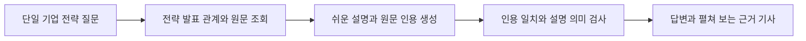

### 2026-11-09 사용자 답변과 품질 기록 분리

- 고정된 행사 답변 양식을 모든 질문에 적용하지 않는다. 첫 문단에서 답하고, 해당 질문에 필요한 배경·활동·목표를 근거 범위에서 이어 설명한다. 소제목도 질문에 따라 생성하고 검증한다.
- `multihop → event_context`는 실제 조회한 인물·기업·행사 경로의 근거로 기존 생성·검사 의존성을 호출한다. 사업 목표는 달성 성과로 바꾸지 않는다. 설명 생성이 실패하면 원문으로 확인한 참여 정보만 유지한다.
- 사용자 화면 순서: 답변 → 추천 질문 → 접힌 검색 과정과 근거. 품질 패널에는 실제 관계·관계 기록 ID·문서 ID·기사·인용·실행 ID를 표시한다. 별도 정답과 비교한 정확도 점수는 계산하지 않는다.
- 응답마다 `private_data/query_runs/`에 실행 기록을 저장하고 화면에서 JSON 다운로드를 제공한다. DB를 변경하지 않고 팀원 라벨 제외를 유지한다.

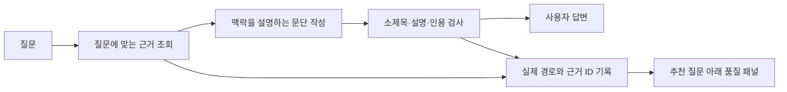

### 2026-11-09 누락 검색과 띄어쓰기 보완

- 기업 이름의 내부 공백을 허용한다. `아모레 퍼시픽`은 `아모레퍼시픽`으로 찾되, `아모레퍼시픽그룹`을 해당 법인으로 바꾸지 않는다.
- `QueryDeps.documents`는 관계 연결 여부와 무관하게 `BulsaeDocument.content`를 읽는다. 그래프 결과가 있어도 원문을 함께 검색하고, 주제별 키워드로 후보를 분산해 한 행사·기사에 치우치는 것을 줄인다.
- 원문 결과는 `source_kind=document`로 표시한다. 원문 검색 결과를 실제 그래프 관계로 표시하거나 질의 중 DB에 관계를 생성하지 않는다.
- 대표·회장 행사 조회는 기업→인물→행사 경로와 독립 원문 근거를 함께 사용한다. 근거에서 확인한 발표·설명·환영인사 등을 포함한다. 예정 참석을 완료된 참석으로 간주하지 않는다.
- 행사 연도는 행사명에 명시된 연도 또는 같은 원문 줄의 제한된 상대 날짜 표현을 이용한다. 발행 연도만으로 행사 연도를 정하지 않는다. `지난해`는 발행 연도보다 한 해 전으로 구분한다. 모호한 날짜는 생성하지 않는다.
- 2025년 매출의 이유·배경 질문은 정형 재무의 연간 개별 금액을 먼저 조회하고, 기사에서 사업 배경을 별도로 찾는다. 그룹·연결·분기 실적을 개별 매출의 원인으로 단정하지 않는다.
- 사업 배경 문단에서 기사 매출·이익 금액과 증감률을 다시 제시하지 않는다. 원문에 없는 `개별` 기준을 붙인 문단도 제외해, 정형 재무와 다른 범위의 수치가 같은 기준처럼 표시되는 것을 막는다.
- 근거 인용에 없는 연도·완전한 날짜를 만든 문장은 제외한다. 원문·기간·주체를 다시 확인하는 의미 검사도 유지한다.
- 원문 검색은 현재 키워드와 근거 문단 점수를 사용한다. 모든 누락이나 동의어를 찾는다고 보장하지 않는다. 추출이 완료된 기사 수와 관계의 완전성은 별개다.

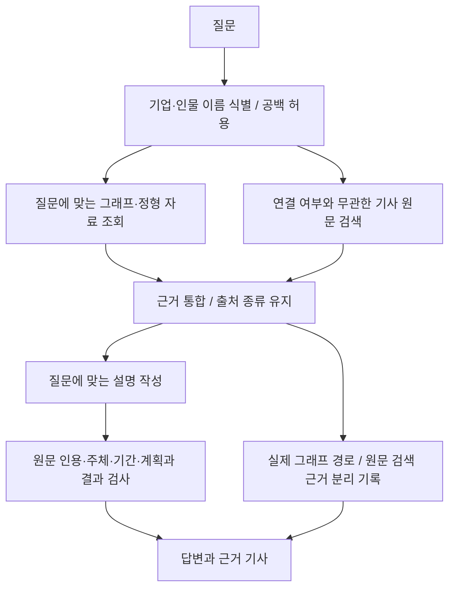

답변 인용은 LLM이 원문을 복사해서 생성하지 않는다. `CitedParagraphs`에서 `evidence_index`와 `quote_ids`를 선택하면 코드가 해당 근거 구간을 원문에서 복원한다. 잘못된 번호·너무 긴 인용은 제외하며, 인용문이 정확하더라도 설명의 의미 검사는 별도로 수행한다.

### 2026-11-09 Streamlit 재무 답변의 사업 배경 보완

매출 질문에는 정형 재무 금액을 먼저 보여주고, 같은 기간의 실적 기사에서 사업 배경을 찾는다. 추가 분석은 원래 질문을 유지하며 후속 질문을 제안하지 않는다.

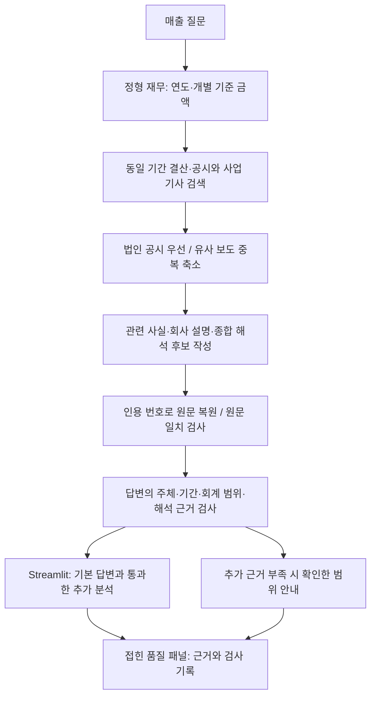

- 해당 기업의 결산·공시를 우선하고 비슷한 보도자료가 검색 자리를 독점하지 않게 한다. 기사 발행 연도만으로 실적 기간을 판단하지 않는다.
- 원문 도입부가 실적 기간을 설명하고 다음 문단이 사업 배경을 설명하는 경우를 포함한다. 관련 없는 수상 연도를 실적 기간으로 간주하지 않는다.
- 인용 원문의 상대 날짜 표현과 생성된 답변의 상대 날짜 표현은 다르게 검사한다. 원문은 그대로 보존하고, 답변이 시점을 임의로 바꾸지 않았는지 별도로 확인한다.
- 서로 떨어진 인용 구간은 각각 원문에서 복원한다. 사이에 있는 무관한 문단을 인용에 끼워 넣지 않는다. 재무 인용에는 도입부의 기간·회계 범위 문맥도 함께 보존한다.
- 최대 6개 분석 후보를 먼저 검사한 뒤 최대 3개를 표시한다. 앞선 후보가 탈락하더라도 뒤의 정상적인 해석 후보를 검사한다.
- 재무 답변에 종합 해석 후보가 없고 서로 다른 문서가 검색됐다면, 해석 작성만 최대 한 번 더 시도한다. 인용·의미 검사를 생략하지 않으며 근거가 부족하면 해석 없이 확인된 내용만 유지한다. `synthesis_attempts`에 시도 횟수를 기록한다.
- 회사가 밝힌 원인과 자료를 종합한 해석을 별도 표시한다. 영업이익 증가 설명을 매출 증가 원인으로 바꾸지 않는다. 연결 기준 사업 배경을 개별 매출의 직접 원인이나 기여액으로 단정하지 않는다.
- 해석이 앞서 제시한 사실을 전제로 사용한다는 이유만으로 중복 제거하지 않는다. 기본 답변의 반복 여부와 같은 종류 문단의 반복 여부를 검사하고, 해석 자체의 추가 정보는 의미 검사로 확인한다.
- 분석을 요청했는데 추가 문단이 하나도 통과하지 않으면 금액만으로 완료 처리하지 않는다. 기본 금액은 유지하고 확인하지 못한 분석 범위를 표시한다.
- `related_diagnostics`는 후보 수·인용 검사 통과 수·의미 검사 결과를 담는 런타임 기록이다. DB 변경 없이 기존 `QueryDeps` 흐름과 Streamlit 실행 경로를 사용한다.

### 2026-11-09 Streamlit과 공통 질의 실행 통합

- Streamlit → `answer_question` → `execute_question` → `build_query_graph`로 실행한다. CLI도 같은 의존성 조립을 사용한다.
- `execute_question`은 LangGraph의 values/updates 스트림으로 최종 상태와 실제 실행 노드를 받는다. 질의 분기, 원래 질문, 근거 검사 정책은 유지한다.
- `present_response`는 전체 저장용 답변과 화면용 `lead`, `sections`, `financial_cards`를 나눈다. 실제 금액을 카드로 옮길 때 비교 결과나 추가 분석을 버리지 않는다.
- DB 스키마·적재에는 변화가 없다. 런타임 `trace.executed_nodes`, `service_version`으로 현재 서버가 공통 경로를 실행했는지 확인한다.
- 화면과 필드별 계약, 호출 흐름도는 [Streamlit 실행과 연결](05_Streamlit_실행_배포.md)에 기록한다.

같은 통합 검증에서 확인한 보완:
- 행사 문맥 검색은 회사명 뒤 `(대표 이름)`만 있는 인용을 개인 참석 근거로 사용하지 않는다. 실제 개인 활동을 보여주는 근거가 있어야 한다.
- 기본 답변의 문단 중복 제거는 공백 정리 후 동일한 문장에만 적용한다. 비슷하지만 추가 사실이 있는 문단은 유지한다.
- 회사가 밝힌 원인은 한 문서의 직접 설명으로 한정한다. 그룹 설명과 법인 공시를 합쳐 회사의 말로 바꾸지 않는다.
- 일반 질문의 추가 분석이 인용 검사에서 모두 탈락하면 짧은 사실 설명만 한 번 재작성한다. 원문·의미 검사는 그대로 수행하고 재시도도 탈락하면 기본 답변만 유지한다.


### 재무 분석: 그래프 우선 검색 (2026-11-09)

재무 금액은 기존 정형 재무에서 조회합니다. 추가 분석은 기업의 실제 전략·사업 관계를 1~2홉 따라가며,
각 관계의 `source_document_id`에 해당하는 원문을 읽습니다. 문서 ID 조회는 추가 그래프 홉으로 세지 않습니다.

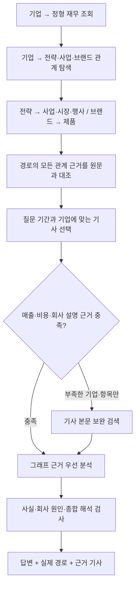

- `enrich`의 `business_paths` 의존성은 기존 불새 소유 관계와 정규화 링크만 읽습니다. `B_` 노드·관계는 탐색에서 제외합니다.
- 전략·사업 활동 경로를 우선해 최대 300개 경로 후보를 조회합니다. 전체 그래프의 누락 없는 탐색을 보장하는 수치는 아닙니다.
- 모든 경로의 연결성과 허용 관계 패턴, 각 관계의 원문 근거를 확인합니다. 이름만으로 노드를 이어 붙이지 않습니다.
- 정규화 링크는 동일 대상을 찾기 위한 보조 링크이며 사업 관계 홉에 포함하지 않습니다.
- 기사에 연도가 등장한다는 것만으로 재무 원인으로 인정하지 않습니다. 도입부의 기간·주제와 회사·그룹·연결/개별 범위를 검사합니다.
- 기업별 매출·판매, 비용·수익성, 회사 설명 관점에서 기간에 맞는 그래프 연결 기사 2건 미만인 항목만 원문 검색으로 보완합니다. 이 기준은 검색 충족도이며 인과관계가 검증되었다는 의미가 아닙니다.
- 검색 충족도는 통과했지만 그래프만으로 만든 답변 후보가 인용·의미 검사에 모두 실패하면, 원문 보완 검색과 분석을 한 번만 추가 실행합니다. 원인 분석 질문에서 사업 사실만 통과한 경우에는 비용·수익성과 회사 설명을 보완합니다. 실패하더라도 앞서 통과한 그래프 사실과 인용을 유지합니다.
- 인용 형식·회사 범위 때문에 후보가 모두 탈락하면 같은 근거로 짧은 사실 문장을 한 번 재작성합니다. 검사 기준을 완화하지 않습니다. 그룹 해석이라는 뒷문장으로 앞 문장의 법인 영업이익 증가 단정을 정당화하지 않습니다.
- 매출과 성장 전략을 함께 묻는 질문도 같은 그래프 우선 분석 단계로 연결합니다. 별도 기사 검색을 먼저 실행하지 않습니다.
- 정제된 기사 근거는 최대 16개 기록을 분석에 사용합니다. 그래프 자료를 우선하며 같은 문서가 보완 검색에도 나오면 그래프 출처를 보존합니다.
- 전략 발표나 경로 존재를 실제 매출·영업이익의 원인으로 간주하지 않습니다. 회사의 직접 설명과 근거를 종합한 해석을 별도 검사합니다.
- 품질 영역은 실제 출발·도착 노드와 관계, 관계 기록 ID, 각 관계의 근거 문서·기사 링크를 보여줍니다.
- `trace.graph_paths`는 조회 경로, `trace.answer_graph_paths`는 답변 인용의 기사를 찾은 경로입니다. 경로에 도달했다고 경로 전체가 최종 답변의 주장이 되는 것은 아닙니다.
- `trace.hops`는 답변에 사용된 경로의 최대 길이, `trace.retrieved_graph_hops`는 조회 경로의 최대 길이입니다. 현재 사업 경로·대표 행사 경로·직접 관계 조회에 적용되며 처리 단계 수를 뜻하지 않습니다.
- `related_graph_paths` 및 trace 필드는 실행 기록이며 DB 스키마가 아닙니다. DB 적재·정규화·관계 변경을 수행하지 않습니다.

### 최종 요약과 LLM 분석 (2026-11-09)

`enrich → finalize → 응답 표시` 순으로 마무리합니다. `finalize`는 검색 경로와 관계없이
최종 채택된 사실·정형 수치만 받아 핵심 요약과 질문에 맞는 분석을 작성합니다.
조회 후보 전체나 앞서 생성한 해석은 새 분석의 사실 전제로 사용하지 않습니다.

- 한 기사에 서로 다른 사실이 있다면 이를 연결해 분석할 수 있습니다. 문서 2건이나 특정 홉 수를 필수 조건으로 두지 않습니다.
- 요약은 확인된 사실만, 분석은 그 사실로부터의 합리적인 해석을 담습니다. 회사가 밝힌 설명과 LLM의 결론을 혼동하지 않습니다.
- 원문에 분석 결론이 그대로 없어도 허용하되, 없는 사건·수치·비용 절감 등의 전제를 추가하거나 법인·그룹·기간·회계 범위를 바꾸면 제외합니다.
- 재무 카드는 원래 수치를 유지합니다. 본문의 이전 설명은 요약으로 대체하며, 출처·관계 경로와 요약 전 내용은 품질 기록에 남깁니다.
- 분석이 있으면 “이 분석은 답변 데이터를 바탕으로 추론한 결과이므로 100% 확실하지 않을 수 있습니다.”를 한 번만 표시하고 저장용 답변에도 포함합니다.
- 작성·검사에 실패하면 기존 답변을 유지합니다. 추가 DB 조회나 쓰기는 수행하지 않습니다.

### 행사 참여 답변의 대시보드 (2026-11-09)

기존 검색 흐름을 유지하고 `finalize`에서 행사 답변의 출력 형식을 정리합니다.

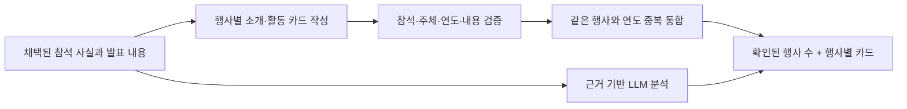

- 대표·회장의 행사 조회 또는 행사 참석·참여 질문에는 `event_cards`를 생성합니다. 이름, 연도, 참석 인물, 행사 소개, 발표·활동, 사실 ID와 출처 번호를 보관합니다.
- 행사 소개·발표 내용은 참석 사실에 연결된 채택 원문 인용으로 보충하고 별도 의미 검사를 적용합니다. 근거가 없으면 빈 값으로 유지합니다. 초청·참석 예정만 확인된 기록은 실제 참석 건수로 표시하지 않습니다.
- 동일 이름·연도의 행사에 관한 여러 기사와 여러 참석자는 행사 한 건으로 집계하며 연도가 다른 행사는 분리합니다. 이름이 다른 행사 별칭은 작성 단계에서 동일 행사라는 근거가 있을 때만 통일합니다.
- `event_dashboard`는 통과한 카드 수, 활동 내용이 있는 카드 수, 카드가 인용한 고유 기사 수를 코드로 계산합니다. 실제 전체 참석 이력을 보장하는 수치가 아닙니다.
- 화면에는 확인된 참석 행사 수를 가로로 긴 카드 하나로 표시하고, 행사명·소개·발표/활동을 행사별 전체 너비 카드에 묶어 세로 나열합니다. 2열 배치 없이 AI 통합분석과 근거 펼침 영역으로 이어집니다. 활동 건수와 기사 건수는 런타임 기록에만 유지합니다. 이전 목록 요약을 중복 표시하지 않습니다. 저장 답변에도 모든 행사 카드 내용을 포함합니다.
- 카드 작성·검증이 실패하면 기존 근거 기반 답변을 유지합니다. 이 변경은 런타임 출력 구조에만 적용되며 DB나 팀원 데이터를 수정하지 않습니다.

### 재무 답변의 보고서식 표시 (2026-11-09)

재무 답변은 수치 카드 아래에 `매출/영업이익 주요 요인 → 요인별 제목과 글머리표 → AI 통합분석` 순서로 표시합니다.
요인과 해석을 바둑판 카드로 나누지 않습니다. `interpretation` 문단만 AI 통합분석에 들어가며 회사 설명과 보도 사실은 요인 영역에 유지합니다.
최종 작성 지침은 한 항목에 핵심 문장 1~3개를 글머리표로 쓰도록 합니다. 기존 답변은 문장을 바꾸지 않고 문단별 글머리표로 표시합니다.
동일 기업·연도·기간·회계 기준의 금액만 재진술하는 단독 문단은 화면에서 생략하되, 비교·증감 설명과 다른 범위의 수치는 보존합니다.
출처와 검증 기록, 내려받는 기존 답변은 유지합니다. 근거만으로 결정적 인과관계를 입증할 수 없으므로 공통 제목에 이를 단정하지 않습니다.

### 반복 질문 응답과 시간 기록 (2026-11-09)

Streamlit은 같은 세션에서 동일 질문·모델 설정의 성공 답변을 5분간 최대 5건 재사용합니다. 오류 답변은 저장하지 않으며 질문이나 모델이 바뀌면 새로 조회합니다. 원래 실행 ID·출처·생성 시각은 보존하고 품질 펼침 영역에서 재사용 여부를 안내합니다. 새 DB 조회로 표시하지 않습니다. `trace.node_timings`는 실제 LangGraph 단계별 경과 시간을 기록합니다. 최초 질문의 생성·검증 절차와 DB는 변경하지 않습니다.

### 재무 근거 경로와 분석 문체 (2026-11-09)

재무 금액은 `Company → HAS_FINANCIAL → Financial`에서 읽습니다. 사업 배경은 회사에서 브랜드·제품·전략·활동의 실제 관계를 1~2홉 탐색하고, 관계의 `source_document_id`로 원문을 읽습니다. 기사 조회는 사업 관계가 아니며, `재무 → 기사` 또는 `매출의 원인` 관계를 가정하지 않습니다. LLM이 관계를 통해 찾은 기사와 정형 수치를 종합해 해석합니다.

AI 통합분석은 확인된 전제 → 가능한 작용 방식 → 질문에 대한 해석을 설명합니다. 반복적인 `단정할 수 없다` 경고 대신 분석 첫머리에 실제 기업·그룹·기간·회계 범위를 명시합니다. 불확실성 안내는 하단에 한 번 표시합니다. 없는 사실·기여액·성과를 만들거나 그룹 연결 자료를 법인의 연간 개별 실적 원인으로 바꾸지는 않습니다.
