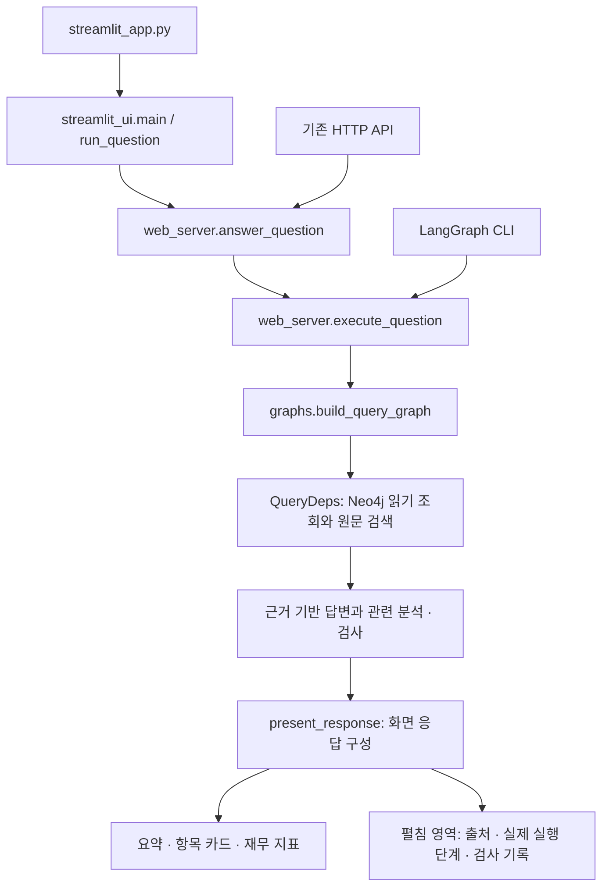

# CONNECT Streamlit 실행과 연결

사용자 화면은 `streamlit_app.py` 하나로 실행합니다. 별도 HTTP 서버를 켤 필요가 없습니다.

## 실행

프로젝트 루트에서 실행합니다. 의존성 설치가 필요하면 먼저 `uv sync`를 실행합니다.

```sh
.venv/bin/python -m streamlit run streamlit_app.py --server.port 18573
```

접속 주소: http://localhost:18573

`.env`의 `OPENAI_API_KEY`, `NEO4J_URI`, `NEO4J_USERNAME`, `NEO4J_PASSWORD`, `NEO4J_DATABASE`를 사용합니다. 비밀값은 화면이나 실행 기록에 넣지 않습니다. 생성 모델은 `BULSAE_LLM_MODEL`, 검사 모델은 `BULSAE_REVIEW_MODEL`을 사용하며, 각각 미설정 시 `gpt-4.1`입니다.

Python 모듈을 수정한 뒤 기존 서버가 실행 중이면 터미널에서 Ctrl+C로 종료하고 같은 명령으로 재시작합니다. 브라우저를 새로고침하고 새 질문을 제출해야 새 답변이 생성됩니다. 이전 세션의 저장된 답변은 자동으로 다시 생성하지 않습니다.

## 실제 연결 경로



명령행 `langgraph-question`, `langgraph-ask`도 동일한 `execute_question`을 사용합니다. 별도의 모델·검색 연결 코드를 유지하지 않습니다. 기존 HTTP 서버는 호환용이며 Streamlit이 해당 서버나 정적 사이트에 요청하지 않습니다.

## 화면

- 첫 화면: **기업 정보는 한눈에, 분석은 더 깊게**. 분홍색 입력과 미니멀한 카드 디자인을 유지합니다.
- 제출 즉시 질문이 제목이 되고 안내 문구와 큰 입력창이 사라집니다. 로딩 이후 답변 대시보드가 표시됩니다.
- 질문에 직접 답한 뒤 근거가 있으면 관련 사실, 회사가 밝힌 원인, 자료를 종합한 해석을 함께 표시합니다. 후속 질문은 추천하지 않습니다.
- 재무 금액은 지표 카드에 표시합니다. 같은 금액의 목록을 본문에 중복 표시하지 않고 비교 차이와 설명은 유지합니다.
- **새 질문**으로 입력 화면에 돌아가고 **답변 저장**으로 금액·분석·출처가 담긴 TXT를 받습니다.
- **검색 과정과 근거 · 품질 확인**에는 문서 ID·기사 링크·인용문·실제 관계·검사 결과·실행한 LangGraph 노드가 있습니다.

## 응답 형식

| 필드 | 화면에서 쓰는 방식 |
|---|---|
| `question` | 사용자가 제출한 원래 질문, 화면 제목 |
| `status` | 처리 상태, 품질 기록 |
| `answer` | 금액과 설명을 포함한 전체 저장용 답변; 카드가 없을 때 화면 대체 본문 |
| `lead` | 실제 기본 답변에서 분리한 요약; 별도 요약이 없으면 빈 문자열 |
| `sections[].heading` | 항목 카드 제목 |
| `sections[].text` | 검사를 통과한 설명 |
| `sections[].section_type` | `basic`은 기본 답변, `additional`은 관련 분석 |
| `sections[].kind` | 보도 사실·회사 원인 설명·종합 해석 구분 |
| `sections[].sources` | 근거 펼침 영역의 출처 번호와 연결 |
| `financial_cards[].company` | 기업 이름 |
| `financial_cards[].label` | 실제 조회한 지표 이름 |
| `financial_cards[].value` | 실제 정형 자료의 원 단위 정수; 없는 값은 카드 생성 안 함 |
| `financial_cards[].year` | 회계 연도 |
| `financial_cards[].period` | 연간·분기 등 실제 기간 |
| `financial_cards[].scope` | 실제 연결·개별 기준 |
| `sources` | 중복 정리한 출처와 원문 인용 |
| `trace` | 조회 경로·검증·모델·실제 실행 노드·서비스 버전 |

조회한 정형 재무의 연도·기간·범위를 보존합니다. 연결 기준 기사 설명을 개별 매출의 직접 원인으로 바꾸지 않습니다. 회사가 밝힌 원인과 여러 자료를 종합한 해석은 구분하며, 부족한 내용을 화면용으로 만들지 않습니다.

## 검증과 기록

자동 테스트는 외부 API·DB 대신 시험 데이터를 사용합니다. 실제 연결 검증은 실행 중인 브라우저에 질문을 제출하고 Neo4j 조회와 LLM 응답, 화면을 별도로 확인합니다. 두 결과는 구분해서 기록합니다.

실행별 응답은 `private_data/query_runs/<run_id>.json`에 저장합니다. 원문 발췌가 포함되므로 공개하지 않습니다. `trace.executed_nodes`는 예상 경로가 아니라 해당 요청에서 실제 완료된 LangGraph 단계입니다. 새 서비스는 `streamlit-unified-v1`로 표시됩니다.

Neo4j 노드·관계·스키마·검토 상태는 변경하지 않습니다. 원문 검색 자료를 실제 그래프 관계처럼 표시하지 않습니다.

## 공개 배포와 구분

Streamlit Community Cloud 배포 주소:
https://mle-02-p2-team1-g8nyr7ga84jec3p54rbrzf.streamlit.app/

| 배포 설정 | 값 |
|---|---|
| 저장소 | `encore-ai-campus/mle-02-p2-team1` |
| 브랜치 | `main` |
| 진입점 | `streamlit_app.py` |
| Python | 3.12 |
| 의존성 | `uv.lock`을 사용한 `uv sync` |
| 접속 설정 | Community Cloud의 App settings → Secrets |

Secrets에는 기존 환경의 `OPENAI_API_KEY`, `NEO4J_URI`, `NEO4J_USERNAME`,
`NEO4J_PASSWORD`, `NEO4J_DATABASE`를 각각 TOML 문자열로 입력합니다.
모델을 별도로 지정하려면 `BULSAE_LLM_MODEL`, `BULSAE_REVIEW_MODEL`도 설정합니다.
비밀값은 GitHub 파일에 넣지 않습니다.

클라우드 앱은 로컬 PC와 독립적으로 실행됩니다. `main`에 반영된 코드는 같은
배포 주소에 적용됩니다. 기존 `.chatgpt.site` 주소와 `localhost:18573`은 별도 화면입니다.
클라우드의 `private_data/query_runs/` 기록은 영구 보관용이 아니므로 필요한 답변은
화면의 **답변 저장**으로 내려받습니다. 기존 `Dockerfile.streamlit`은 다른 Python
호스팅 환경에 배포할 때 사용할 수 있습니다.
